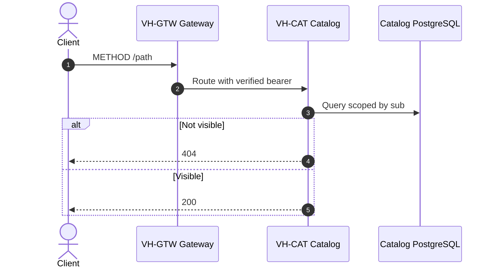
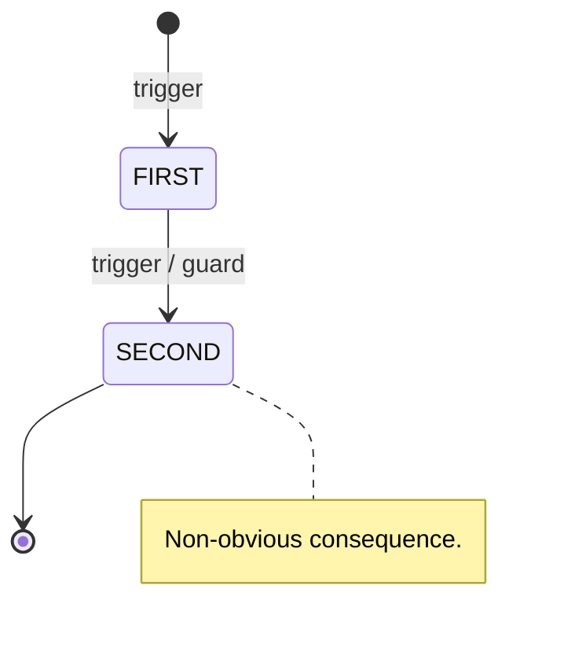

# Page templates

Copy one template, replace every placeholder, delete what does not apply. Each page holds exactly one Mermaid block.

## Sequence page (`docs/architecture/flows/NAME.md`)

````markdown
---
id: vh-NAME
slug: NAME
type: sequence-diagram
system: vellumhub
status: implemented-in-repository
related: [vh-service-OWNER, vh-OTHER-PAGE]
---

# Sequence — WHAT HAPPENS

One or two sentences: the guarantee this flow gives and what it explicitly does not.



| Step | Implementation |
| --- | --- |
| Step name | [Class](../../../services/SERVICE/src/main/java/PATH.java) |

Short note on evidence (which test proves it) and what is not proven.
````

## State-machine page (`docs/architecture/states/NAME.md`)

````markdown
---
id: vh-NAME
slug: NAME
type: state-machine
system: vellumhub
container_code: VH-XXX
status: implemented-in-repository
related: [vh-RELATED-FLOW]
---

# State machine — WHAT LIFECYCLE

**Persisted** in `table.column` (`CHECK status IN (...)`). Why the states exist in one sentence.



| Transition | Guard | Implementation |
| --- | --- | --- |
| FIRST → SECOND | condition | `Class.method` |
````

## Frontmatter checklist
- `id` is `vh-` + kebab-case and unique; `slug` equals the file stem.
- Every `related` id exists.
- Add the page to `docs/architecture/README.md` and to `pages` in `architecture-explorer.html`.
