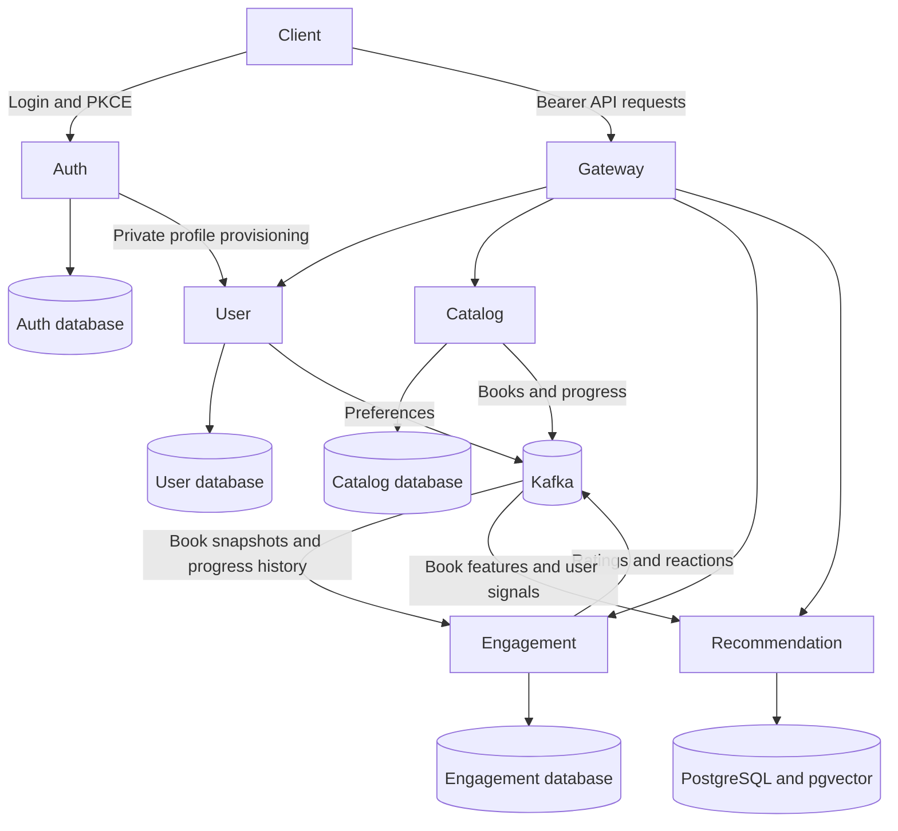
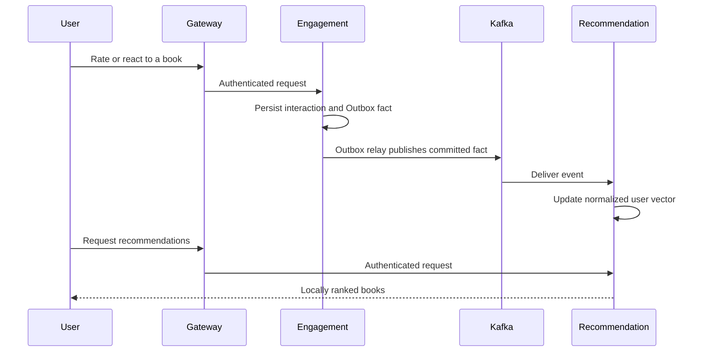

# VellumHub

> A social reading and recommendation platform used to explore when independent services, asynchronous state, and stronger delivery guarantees justify their operational cost.

[](https://openjdk.org/)
[](https://spring.io/projects/spring-boot)
[](https://kafka.apache.org/)
[](https://www.postgresql.org/)
[](https://github.com/pgvector/pgvector)
[](https://www.docker.com/)
[](https://kubernetes.io/)

VellumHub covers the complete reading journey: users create an account, choose literary preferences, discover or request books, organize shared lists, track reading progress, rate and react to titles, and receive recommendations that learn from those interactions.

The central engineering problem is **serving recommendations without depending on the availability of three other services for every read**. Synchronous fan-out would avoid duplicated state, but inherit upstream latency and failures. VellumHub instead uses Kafka-carried domain facts and service-owned PostgreSQL read models, accepting bounded eventual consistency for autonomous recommendation serving.

**Engineering evidence:** Controlled distributed runs measured sub-0.8 s p95 interaction-to-visible ranking and 60/60 successful recommendation reads with User, Catalog, and Engagement unavailable. Transactional Outbox and idempotent consumers protect canonical Book, Reading Progress, Rating, and Reaction streams.

**Architecture at a glance:** [C4/service boundaries and key flows](docs/architecture/README.md) · [diagram explorer](docs/architecture/architecture-explorer.html). Source code and versioned contracts define runtime behavior; these pages summarize it.

**Explore:** [Measured behavior](#measured-recommendation-behavior) · [Architecture](#architecture) · [Authentication](#authentication-and-authorization) · [API documentation](#explore-the-api) · [Run locally](#run-locally) · [Quality](#verification-strategy) · [Observability](#observability-and-operational-feedback) · [Roadmap](#current-status-and-roadmap)

---

## What VellumHub Does

A user's actions form one connected product journey:

1. **Join:** register with email and password or authenticate with Google.
2. **Personalize:** choose preferred genres to create a useful cold-start profile.
3. **Discover:** browse the catalog, import a book by ISBN, or request a missing title.
4. **Organize:** create book lists, add titles, manage members, and assign collaboration roles.
5. **Read:** manage reading status, record progress, and preserve a progress history.
6. **Engage:** rate books and react to content.
7. **Improve recommendations:** every preference, rating, reaction, and progress signal refines the user's vector profile.

### Product capabilities

| Domain | Implemented capabilities |
|---|---|
| Identity | Registration, login, Google authentication, profile lookup, and user management |
| Preferences | Genre preferences used to seed recommendation profiles before interaction history exists |
| Catalog | Book lifecycle, ISBN import through Google Books, cover upload/retrieval, and bulk lookup |
| Curation | Book requests and approval workflow for titles missing from the catalog |
| Collaborative lists | List lifecycle, book membership, member management, and collaboration roles |
| Reading | Reading status, progress updates, personal reading list, and replicated progress history |
| Engagement | Ratings, current-user rating lookup, rating aggregation, and reactions |
| Recommendations | Event-fed book projections, user profile learning, ANN retrieval, re-ranking, and popularity fallback |

## Event-Driven Architecture at a Glance

VellumHub applies [Data on the Outside versus Data on the Inside](https://queue.acm.org/detail.cfm?id=3415014) at service boundaries and uses [Event-Carried State Transfer](https://martinfowler.com/articles/201701-event-driven.html) where a consumer needs source data to work autonomously.

| Architectural concern | VellumHub's approach |
|---|---|
| Data on the inside | Each domain owns a private PostgreSQL database, its mutable current state, business invariants, and local transaction boundary. |
| Events on the outside | Services publish versioned integration facts through Kafka; producers announce committed changes rather than issuing commands to consumers. |
| Event collaboration | User, Catalog, and Engagement publish what happened; Engagement and Recommendation decide independently how those facts affect their own models. |
| Local projections | Book snapshots, reading history, book features, user vectors, and recommendation response data are materialized where they are consumed. |
| Query autonomy | Recommendation and replicated engagement flows read local tables instead of synchronously joining or calling the source services. |
| Consistency model | A service is transactionally consistent inside its boundary; projections across boundaries converge asynchronously. |
| Failure model | Selected Catalog and Engagement mutations now use transactional Outbox, per-aggregate ordering and durable consumer checkpoints; full DLT replay and rollout verification remain open. |

The platform has **six independently deployable services**: Auth, Gateway, User, Catalog, Engagement, and Recommendation. Auth and the four domain services own separate PostgreSQL databases; Gateway uses Redis for rate limiting.

**Domain read-cache status:** Recommendation ([#36](https://github.com/Luca5Eckert/VellumHub/issues/36), [PR #367](https://github.com/Luca5Eckert/VellumHub/pull/367)) and Catalog ([#366](https://github.com/Luca5Eckert/VellumHub/issues/366), [PRs #369](https://github.com/Luca5Eckert/VellumHub/pull/369) and [#370](https://github.com/Luca5Eckert/VellumHub/pull/370)) implement Redis DTO cache-aside. Catalog hardening added bounded DB fallback, safe phased invalidation, key/memory protections and real signed-JWT HTTP tests. The [72k authenticated OFF/ON Catalog run](https://github.com/Luca5Eckert/VellumHub/actions/runs/43666479401) passed with equivalent responses: warm/c32 p95 44.89→10.35 ms, mixed80/c32 40.76→19.67 ms, cold/c8 8.10→13.41 ms (**regression**). These are CI/Testcontainers measurements, **not** production throughput. Both caches are **ON in local Compose/Kind configuration**, isolated from Gateway rate limiting; application defaults and the unprovisioned production overlay are **OFF**. See [C4 + cache sequence](docs/architecture/flows/catalog-cache.md), [Catalog runbook](docs/CATALOG_REDIS_CACHE.md) and [Recommendation evidence](docs/RECOMMENDATION_REDIS_CACHE.md).

## Measured Recommendation Behavior

The architecture deliberately accepts asynchronous convergence between service boundaries so the recommendation query path can stay local. The trade-off is measured directly rather than inferred from component timings.

| Property | Reference evidence |
|---|---:|
| Recommendation quality | **0.599 nDCG@10** vs. **0.066** popularity-only |
| Interaction → visible recommendation | **553–751 ms p95** across two repeated 90-event reference runs |
| Recommendation read path | **15.98–19.86 ms p95** after local-state convergence |
| Freshness correctness | **260/260** interactions produced the expected observable ranking change |
| Read autonomy | **60/60** authenticated reads succeeded with User, Catalog, and Engagement unavailable |
| Synchronous upstream fan-out | **0** calls after a recommendation request reaches Recommendation |

The freshness benchmark follows a `CreatedRatingEvent` from Kafka publication through the rating consumer, `user_profiles` update and pgvector ranking, until an authenticated `GET /recommendations` observes the expected book at rank #1.

Two reference executions measured **553.05 ms** and **751.17 ms p95** for the 90-event burst. Across their scenarios, all **260/260** interactions became visible with zero freshness failures. Recommendation reads then measured **15.98–19.86 ms p95**, with **60/60** reads succeeding while the three upstream domain services were unavailable. The consistency window and read autonomy are measured separately.

Recommendation quality is measured separately through a reproducible model-backed offline evaluation over a synthetic dataset of **120 books and 24 profiles**. The current 70/30 semantic+popularity ranker reached **0.599 nDCG@10**, compared with **0.066** for popularity-only. A semantic-only ablation reached **1.000**, making the current popularity weight an explicit tuning target rather than hiding the regression.

These measurements are controlled CI/Testcontainers and offline-evaluation evidence. They are not production SLAs, online A/B-test results, or maximum-throughput claims. Reproduce them with the [distributed benchmark guide](services/recommendation-service/benchmark/README.md) and [offline quality evaluation guide](services/recommendation-service/evaluation/README.md).

## Architectural trade-offs

The project favors Kafka-carried facts and local read models over request-time fan-out, accepting eventual consistency and the costs of idempotent event delivery. Catalog owns current reading progress; Engagement builds derived history. The 70/30 recommendation weighting is a documented heuristic, **not** a proven universally optimal formula.

Implementation details: [architecture overview](docs/architecture/README.md), [event contracts](docs/BOOK_EVENTS.md), [consumer consistency](docs/CONSUMER_IDEMPOTENCY.md). Plans, alternatives and detailed reasoning are maintained separately from this public project overview.

## Architecture

The source-linked [C4 context](docs/architecture/diagrams/c4-context.md), [C4 containers](docs/architecture/diagrams/c4-containers.md), [Catalog L3 components](docs/architecture/diagrams/c4-catalog-components.md), [coded service registry](docs/architecture/services/README.md), [sequences](docs/architecture/README.md) and [state machines](docs/architecture/states/outbox-delivery.md) form the canonical architecture knowledge base. The diagram below is a compact overview.

Domain API requests enter through the reactive Gateway. OAuth/OIDC login goes directly to Auth, the platform's identity authority. Each domain API independently validates Auth-issued access tokens. Kafka carries cross-domain facts into service-owned projections.



### Service ownership

| Service | Owns | Boundary |
|---|---|---|
| [Auth](services/auth-service/README.md) | Identities, Argon2id credentials, Google federation, OAuth clients/grants, JDBC sessions, signing keys and JWKS | Sole access-token issuer; provisions profiles privately |
| [Gateway](services/gateway-service/README.md) | API routing, JWT validation, verified Token Relay, Redis-backed rate limiting and API discovery | No domain database or token issuance |
| [User](services/user-service/README.md) | Profiles and genre preferences | No credential storage, login or token signing |
| [Catalog](services/catalog-service/README.md) | Books, requests, covers, lists, memberships and current reading progress | Canonical Book/Reading Progress state and Outbox |
| [Engagement](services/engagement-service/README.md) | Ratings, reactions, book snapshots and reading-progress history | Canonical feedback and derived history |
| [Recommendation](services/recommendation-service/README.md) | Book features, user vectors, response projections and ranking | Local serving without synchronous domain-service calls |

| Directory | Contents |
|---|---|
| `services/` | Six deployable applications and their individual READMEs |
| `lib/` | Kafka contracts, shared JWT validation and distributed test support |
| `integration-tests/` | Cross-service distributed E2E suites |
| `infra/` | Container configuration, scripts and observability stack |
| `deploy/kubernetes/` | Kustomize bases/overlays and Argo CD application |
| `postman/` | Contract-derived collection and cross-service workflows |
| `training/` | Versioned offline training-data exports |
| `docs/` | Architecture, event contracts and operational runbooks |

## Authentication and Authorization

Auth implements OAuth 2.0/OIDC Authorization Code + PKCE S256 using Spring Authorization Server. It authenticates local accounts with Argon2id or federates Google, resolves a stable UUIDv7 identity, and provisions User with profile data only. External identities are bound by verified `(issuer, subject)`; matching email addresses do not automatically link accounts.

API access tokens are RS256-signed JWTs with `typ=at+jwt`. Gateway and the four domain APIs validate issuer, audience, lifetime, type and signing key through Auth's JWKS. Only Auth holds the private key. Gateway forwards a verified bearer; APIs authorize locally without consulting Auth/User on every domain request.

Each protected domain operation requires an explicit OAuth scope and its USER/ADMIN role. For example, a token limited to `user:read` can read User endpoints but cannot read Catalog. ADMIN does not imply scopes, and machine grants cannot impersonate a human on these routes. Ownership and resource-specific rules remain separate from scope checks.

Spring Session JDBC persists Auth browser sessions, with a 30-minute idle timeout and a 12-hour absolute lifetime by default. Logout ends the current session; an already-issued API token remains valid until expiry and verifier clock skew. Public PKCE clients have no refresh-token grant in the current configuration.

[Scope/endpoint matrix and client configuration](docs/SECURITY_SCOPES_RBAC.md) · [Auth setup and ownership](services/auth-service/README.md) · [JWT/JWKS operations](docs/SECURITY_JWKS_RFC9068.md) · [Google and session runbook](docs/SECURITY_OIDC_LOTE3.md)

## End-to-End Journeys

### From registration to a useful cold start

After Auth creates the identity and provisions its profile, User manages genre preferences and publishes `created-user-preference` when they are created. The recommendation service converts those preferences into a normalized profile vector, allowing relevant results before ratings or reading history exists.

### From reader feedback to a refined profile



Reading-progress events follow the same integration style. Catalog owns the current state, while engagement preserves progress history and recommendation treats progress as another learning signal.

## Recommendation Engine

Recommendation builds independent PostgreSQL + pgvector projections from Kafka facts. Embeddings use 384-dimensional vectors; HNSW retrieves candidates and the ranking pipeline applies semantic/popularity weighting with a popularity fallback. The GET path serves from local state, without synchronous calls to Catalog, User or Engagement.

See [Recommendation service](services/recommendation-service/README.md), [service contract](docs/architecture/services/recommendation.md) and [measured behavior](#measured-recommendation-behavior).

## Event Collaboration and Local Projections

Catalog owns Book and Reading Progress; Engagement owns ratings and reactions; User owns preferences. Each publishes integration facts through Kafka to independently maintained projections. Canonical streams use Outbox and consumer idempotency; legacy listeners have separate compatibility constraints.

Contracts: [Book](docs/BOOK_EVENTS.md), [Engagement](docs/ENGAGEMENT_EVENTS.md), [consumer checkpoints](docs/CONSUMER_IDEMPOTENCY.md) and [event flow](docs/architecture/flows/book-outbox.md).

## Reliability and Data Consistency

PostgreSQL remains canonical per domain. Catalog and Engagement use transactional Outbox for selected state changes; downstream consumers checkpoint canonical events for idempotent application. This is **at-least-once delivery with eventual consistency**, not globally exactly-once processing or Event Sourcing.

Verification uses real-boundary tests where Kafka, PostgreSQL/Flyway and pgvector semantics matter. Production cutover, DLT replay safety and production SLAs are not demonstrated by CI alone. See [distributed testing](docs/DISTRIBUTED_TESTING.md), [Outbox states](docs/architecture/states/outbox-delivery.md) and [operations](docs/OPERATIONS.md).

## Explore the API

With the default stack running, the gateway exposes one API discovery entry point:

```text
http://localhost:8080/docs
```

The selector contains the User, Catalog, Engagement, and Recommendation OpenAPI definitions. Each service remains the source of truth for its contract; the gateway only provides stable routes under `/docs/{service}/v3/api-docs`.

The repository also includes:

- a versioned [Postman collection](postman/VellumHub.postman_collection.json) generated from live OpenAPI contracts;
- a secret-free [local environment template](postman/VellumHub.local.postman_environment.json);
- cross-service workflows using an Auth-issued token for profile validation and authenticated reads;
- CI validation that rejects contract drift or committed credentials.

```bash
python postman/generate.py
python postman/generate.py --check
```

Obtain a bearer from Auth through an explicitly enabled PKCE client. The default read workflow needs `user:read catalog:read engagement:read recommendation:read`; `openid profile` alone grants no domain API access. See [API documentation](docs/api-documentation.md) and the [Postman guide](postman/README.md) for configuration and token handling.

## Run Locally

The six services share a parameterized Java Dockerfile, but retain independent images. Compose project isolation, build-stage selection and Kubernetes layout are documented in [Infrastructure Layout](docs/INFRASTRUCTURE_LAYOUT.md). The canonical Maven Wrapper lives at the repository root. The default `compose.yaml` remains in the repository root; optional Compose overlays and isolated fixtures live under `infra/compose/`, described in the [Infrastructure Layout](docs/INFRASTRUCTURE_LAYOUT.md).

### Prerequisites

- Docker with the Docker Compose plugin
- OpenSSL for the Auth signing key pair
- Java 21 and Maven when running checks outside containers

From the repository root, copy the environment template and edit the five database passwords, `VELLUM_INTERNAL_PROVISION_KEY` (at least 32 characters), and local origins:

```bash
cp .env.example .env
```

Generate the filenames expected by `VELLUM_AUTH_KEY_DIR`. The following commands target Linux/WSL; the private key must be readable by the Auth container's UID 10001:

```bash
umask 077
install -d -m 755 .local/auth-keys
openssl genpkey -algorithm RSA -pkeyopt rsa_keygen_bits:3072 \
  -out .local/auth-keys/signing-private.pem
openssl pkey -in .local/auth-keys/signing-private.pem -pubout \
  -out .local/auth-keys/signing-public.pem
chmod 600 .local/auth-keys/signing-private.pem
chmod 644 .local/auth-keys/signing-public.pem
sudo chown 10001:10001 .local/auth-keys/signing-private.pem

docker compose config --quiet
docker compose up -d --build
docker compose ps
```

Keep the key pair outside Git. `.env.example` sets `VELLUM_AUTH_KEY_DIR=./.local/auth-keys` and a loopback issuer for local development. Auth is the only service that mounts the private key. Google federation is optional and requires its own provider configuration.

For an automated disposable login/PKCE exercise, run `bash infra/scripts/security/run_oidc_lote2_e2e.sh`; it creates test keys and credentials, starts the integration topology, validates the flows, and removes its volumes afterward. Use it in a separate disposable checkout/environment, not alongside a stack whose local data you want to retain. See [Auth configuration](services/auth-service/README.md) and [the integration runbook](docs/SECURITY_OIDC_LOTE2.md).

### Local entry points

| Component | URL |
|---|---|
| API Gateway | `http://localhost:8080` |
| Auth issuer/discovery | `http://127.0.0.1:9000/.well-known/openid-configuration` |
| Central Swagger UI | `http://localhost:8080/docs` |
| Kafka UI | `http://localhost:8090` |

The default Compose topology starts six applications, five PostgreSQL databases, Redis, Kafka, ZooKeeper, and Kafka UI. The repository provides backend APIs and a protocol test harness; it does not include a product frontend.

```bash
docker compose --profile observability up -d --build
```

| Observability component | URL |
|---|---|
| Grafana | `http://localhost:3002` |
| Prometheus | `http://localhost:9090` |
| Loki | `http://localhost:3100` |
| Tempo | `http://localhost:3200` |

For service-specific configuration and standalone execution, use the README inside each directory under `services/`.

## Verification Strategy

The test portfolio uses the narrowest boundary capable of proving each behavior:

| Level | What it protects |
|---|---|
| Domain and application tests | Business rules, state transitions, ranking signals, and errors |
| Controller and mapper tests | HTTP status, request/response mapping, authentication context, and delegation |
| Repository and migration tests | JPA adapters, Flyway, PostgreSQL constraints, pgvector, and HNSW indexes |
| Distributed integration tests | Real Kafka serialization, listener execution, transactions, retry/DLT, projections, convergence, read autonomy, and recommendation freshness |
| Configuration and smoke checks | Gateway/OpenAPI drift, Compose topology, health, and service communication |

Architecture fitness functions add ArchUnit package/cycle checks, Maven Enforcer service-isolation checks, database ownership checks and distributed behavior assertions. CI publishes a per-commit evidence catalog with the results actually executed.

```bash
python3 -m unittest discover -s tools/architecture -p 'test_*.py' -v
python3 tools/architecture/check_service_boundaries.py
python3 tools/architecture/check_database_ownership.py
```

Run the reactor verification (repository/migration tests require Docker even when the `distributed` group is excluded):

```bash
mvn -B -ntp -DexcludedGroups=distributed clean verify
```

Run cross-service E2E separately:

```bash
mvn -B -ntp -Pdistributed-e2e -pl integration-tests/distributed-e2e -am \
  -Dgroups=distributed test
```

Run the Recommendation distributed suites with Docker available. Keep the two benchmark suites in separate Maven processes so each distributed Spring/Testcontainers lifecycle remains isolated:

```bash
mvn -B -ntp -pl services/recommendation-service -am \
  -Dtest=DistributedRecommendationBenchmarkIT \
  -Dsurefire.failIfNoSpecifiedTests=false \
  -Dgroups=distributed-benchmark \
  -Dbenchmark.profile=reference \
  test

mvn -B -ntp -pl services/recommendation-service -am \
  -Dtest=RecommendationFreshnessBenchmarkIT \
  -Dsurefire.failIfNoSpecifiedTests=false \
  -Dgroups=distributed-benchmark \
  -Dbenchmark.profile=reference \
  test
```

CI separates reactor, distributed E2E, OIDC/security, architecture fitness, Postman, CodeQL and image validation. Recommendation benchmarks upload raw evidence; machine-dependent latency percentiles are not treated as universal performance gates.

[Testing guide](docs/DISTRIBUTED_TESTING.md) · [Architecture fitness functions and evidence](docs/ARCHITECTURE_FITNESS_FUNCTIONS.md) · [Benchmark reproduction](services/recommendation-service/benchmark/README.md)

## Observability and Operational Feedback

The local observability profile connects **Prometheus, Grafana Alloy, Loki, Tempo and Grafana** to explain HTTP failures, JVM/database pressure, Kafka lag and projection convergence.

| Signal | Collection path | Current coverage |
|---|---|---|
| Metrics | Actuator/Micrometer → Prometheus → Grafana | All six services; Auth uses private management port `9001` |
| Logs | Docker discovery → Alloy → Loki | All six services are discovered; Gateway/domain services configure structured JSON, while Auth's logging configuration still needs parity |
| Traces | OpenTelemetry Java Agent → Alloy → Tempo | Agent bundled in all six images; Auth does not enable it by default |

The Java Agent does not duplicate metrics export. Loki labels stay low-cardinality (service, level and environment); correlation IDs and trace context stay in log bodies. Alloy forwards bodies without redaction, so credential/payload filtering remains an application responsibility.

Five provisioned dashboards cover platform overview, gateway/HTTP, JVM/database, Kafka flow and recommendation health. Versioned alerts link to incident runbooks. HTTP/recommendation histogram buckets support latency analysis, and missing series remain visible as No data. End-to-end ingestion, sensitive-data checks and Kafka trace continuity are tracked through #214.

[Observability guide](docs/OBSERVABILITY.md) · [Incident runbooks](docs/OBSERVABILITY_RUNBOOKS.md) · [Architecture fitness functions](docs/ARCHITECTURE_FITNESS_FUNCTIONS.md)

## Delivery

The repository defines a Git-based delivery path:

1. GitHub Actions verifies code, migrations, distributed behavior, images, and vulnerabilities.
2. A successful verification on a push to `main` publishes each service image to GHCR with an immutable commit-SHA tag and a convenience `main` tag.
3. Kustomize overlays define local and production runtime differences.
4. Argo CD observes the desired image version declared in Git and reconciles the cluster.
5. Rollback reverts the version change and reconciles the previous desired state.

The base Kubernetes ingress exposes Gateway API routes. Auth browser endpoints require an environment-specific HTTPS route matching the configured issuer. Application containers run as non-root, drop Linux capabilities, declare resource boundaries, and expose liveness/readiness probes. Production databases, Kafka, Redis, and secrets are external interfaces rather than workloads owned by the application manifests.

[CI/CD configuration](docs/CI_CD.md) · [Operations](docs/OPERATIONS.md) · [Database migrations](docs/DATABASE_MIGRATIONS.md) · [Kubernetes and GitOps](deploy/kubernetes/README.md)

## Current Status and Roadmap

| Capability | Status | Reference |
|---|---|---|
| Six services with separate identity/domain ownership | Implemented | [Service map](#service-ownership) |
| Canonical Auth, Google federation, JDBC sessions and Argon2id | Implemented; live-provider/HTTPS setup is environment-specific | [Authentication](#authentication-and-authorization) |
| OAuth scopes and human USER/ADMIN enforcement | Implemented; resource ownership hardening remains #312/#313 | [Authorization matrix](docs/SECURITY_SCOPES_RBAC.md) |
| JVM embeddings and local pgvector ranking | Implemented | [Recommendation engine](#recommendation-engine) |
| Central Kafka contract library | Implemented | [#199](https://github.com/Luca5Eckert/VellumHub/issues/199) |
| Flyway migrations and PostgreSQL verification | Implemented | [#205](https://github.com/Luca5Eckert/VellumHub/issues/205) |
| Metrics, JSON logs, traces, dashboards and alerts | Six-service metric/log discovery; Auth tracing/logging parity and E2E correlation tracked separately | [Observability](docs/OBSERVABILITY.md) |
| CI, immutable images, Kubernetes, Kustomize, and Argo CD | Implemented | [Kubernetes](deploy/kubernetes/README.md) |
| Central Swagger UI and service-owned OpenAPI | Implemented | [API documentation](docs/api-documentation.md) |
| Contract-derived Postman collection and workflows | Implemented | [Postman](postman/README.md) |
| Real Kafka + PostgreSQL/pgvector distributed testing | Cross-service suite and Recommendation benchmarks implemented | [#207](https://github.com/Luca5Eckert/VellumHub/issues/207) |
| Recommendation convergence, read-autonomy, and freshness benchmark | Implemented in PR #286 | [#283](https://github.com/Luca5Eckert/VellumHub/issues/283) |
| Consumer idempotency | #200 implementation merged via #299 for canonical Book/Reading Progress/Rating/Reaction; operational cutover unverified | [#200](https://github.com/Luca5Eckert/VellumHub/issues/200), [#299](https://github.com/Luca5Eckert/VellumHub/pull/299) |
| Transactional outbox | Merged for Catalog progress/Book and Engagement rating/reaction; not production-validated | [#295](https://github.com/Luca5Eckert/VellumHub/pull/295), [#296](https://github.com/Luca5Eckert/VellumHub/pull/296), [#297](https://github.com/Luca5Eckert/VellumHub/pull/297) |
| Broader cross-service E2E coverage | Selected real-boundary flows covered; failure/recovery coverage continues | [Distributed testing](docs/DISTRIBUTED_TESTING.md) |

## Design Principles

Keep domain ownership and contracts explicit; prefer independent reads when they materially improve resilience; validate failure modes at real boundaries; report results with reproducible evidence. Code, contracts and CI establish repository behavior—not production deployment. The [architecture index](docs/architecture/README.md) summarizes the implemented topology.

## Offline Training Data

[`training/`](training/README.md) exports versioned `books.jsonl`, `user_book_signals.jsonl` and a hashed manifest. Current reading state comes from Catalog; canonical feedback and replicated history come from Engagement with explicit provenance. This prepares offline training without changing the direct Catalog → Recommendation event flow.

## Documentation

| Topic | Guide |
|---|---|
| C4 context/containers/components, service codes, sequences and state machines | [Architecture knowledge base](docs/architecture/README.md) · [HTML explorer](docs/architecture/architecture-explorer.html) |
| Service setup and responsibilities | [Service registry](docs/architecture/services/README.md) · [Service READMEs](services) |
| Identity, credentials, Google and sessions | [Auth Service](services/auth-service/README.md) |
| Client scopes, roles and endpoint policies | [OAuth scopes and RBAC](docs/SECURITY_SCOPES_RBAC.md) |
| Signing keys, JWKS and token validation | [JWT/JWKS runbook](docs/SECURITY_JWKS_RFC9068.md) |
| Event payloads, ordering and projection recovery | [Book events](docs/BOOK_EVENTS.md), [Engagement events](docs/ENGAGEMENT_EVENTS.md), [Idempotency](docs/CONSUMER_IDEMPOTENCY.md) |
| Correctness, failure boundaries and evidence | [Distributed testing](docs/DISTRIBUTED_TESTING.md), [Fitness functions](docs/ARCHITECTURE_FITNESS_FUNCTIONS.md) |
| Recommendation measurements and reproduction | [Distributed benchmark](services/recommendation-service/benchmark/README.md), [Offline quality evaluation](services/recommendation-service/evaluation/README.md) |
| Metrics, logs, traces and incident response | [Observability](docs/OBSERVABILITY.md), [Runbooks](docs/OBSERVABILITY_RUNBOOKS.md) |
| Deployment and operations | [CI/CD](docs/CI_CD.md), [Operations](docs/OPERATIONS.md), [Kubernetes](deploy/kubernetes/README.md) |
| API exploration and request workflows | [OpenAPI](docs/api-documentation.md), [Postman](postman/README.md) |


### SEC-12: per-user Engagement and Recommendation authorization

Engagement now hides non-owned ratings and reactions and disambiguates public
book-rating reads as `GET /rating/books/{bookId}`. Recommendation checks that
its query identity matches the authenticated subject without adding cross-service
fan-out. The full contract, HTTP decisions and rollback steps are documented
in [SEC-12](docs/SECURITY_OWNERSHIP_SEC12.md).


### Kafka service identities (SEC-14)

Kafka clients use separate service principals with broker ACLs for exact
streams, retry/DLT and consumer groups; they do **not** forward HTTP bearer
credentials. The production Kubernetes overlay requires SASL_SSL and managed
secrets. The authenticated local Compose overlay and CI negative ACL tests are
in [SEC-14](docs/KAFKA_SERVICE_IDENTITIES_SEC14.md).
