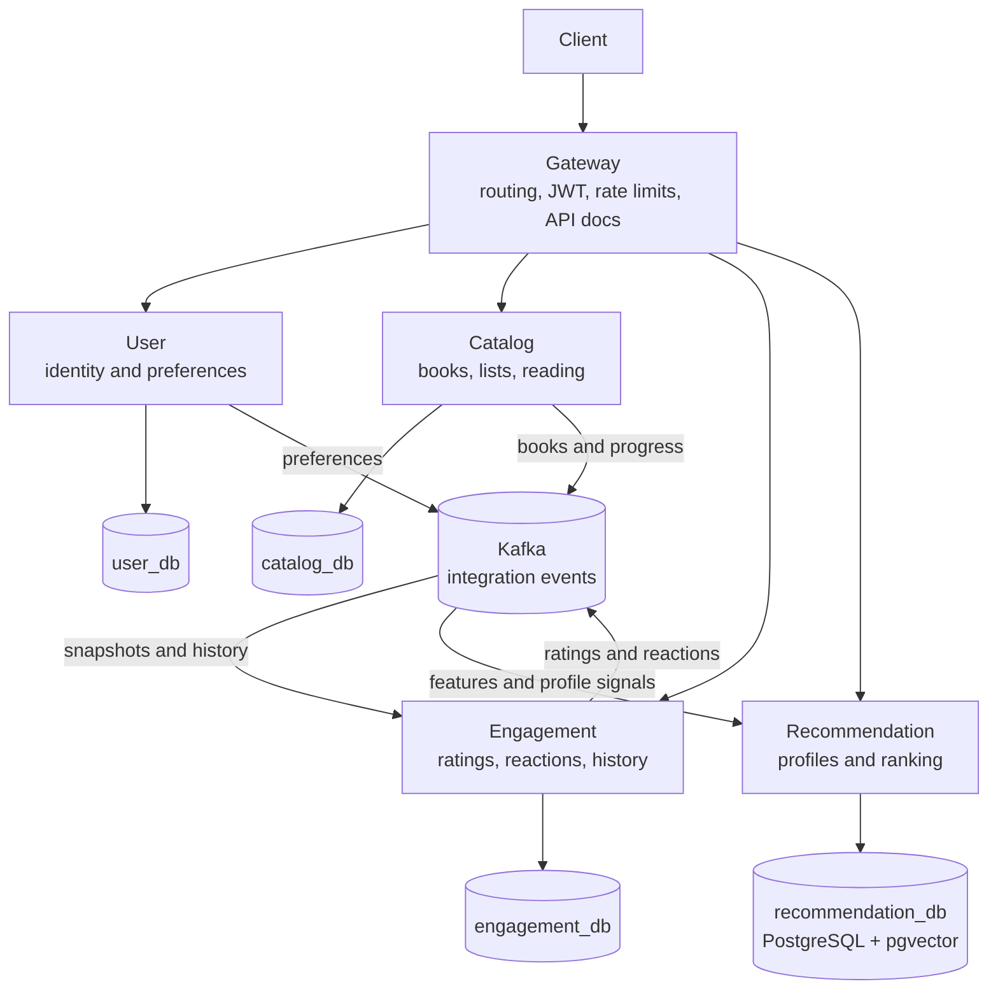
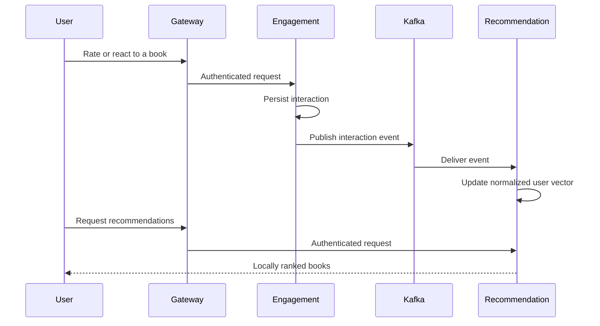

## Security migration status — 27 October 2026

PRs #320, #321, #330, #331 and #334 are merged. The Auth service is implemented and the OIDC integration overlay verifies Gateway and domain APIs against Auth-issued JWTs.

The default runtime has not been cut over yet: base Compose and Kubernetes still use the User Service as the JWT/JWKS source. There is no real frontend or production user data to migrate today. Issue #317 now owns the backend cutover: finalize the Auth contract, switch all validators to Auth, then remove legacy authentication from User.

# VellumHub

> A social reading and recommendation platform used to explore when independent services, asynchronous state, and stronger delivery guarantees justify their operational cost.

[](https://openjdk.org/)
[](https://spring.io/projects/spring-boot)
[](https://kafka.apache.org/)
[](https://www.postgresql.org/)
[](https://github.com/pgvector/pgvector)
[](https://www.docker.com/)
[](https://kubernetes.io/)

VellumHub covers the complete reading journey: users create an account, choose literary preferences, discover or request books, organize shared lists, track reading progress, rate and react to titles, and receive recommendations that learn from those interactions.

The central engineering problem is **serving recommendations without depending on the availability of three other services for every read**. Synchronous fan-out would avoid duplicated state, but inherit upstream latency and failures. VellumHub instead uses Kafka-carried domain facts and service-owned PostgreSQL read models, accepting bounded eventual consistency for autonomous recommendation serving.

**Engineering evidence:** Controlled distributed runs measured sub-0.8 s p95 interaction-to-visible ranking and 60/60 successful reads while User, Catalog, and Engagement were unavailable. Recent hardening introduced ordered Transactional Outbox streams ([Catalog progress #295](https://github.com/Luca5Eckert/VellumHub/pull/295), [Catalog books #296](https://github.com/Luca5Eckert/VellumHub/pull/296), [Engagement #297](https://github.com/Luca5Eckert/VellumHub/pull/297)) and transactional consumer idempotency for canonical streams ([#299](https://github.com/Luca5Eckert/VellumHub/pull/299)). **Merged code does not establish a coordinated production cutover, global exactly-once guarantees or DLT replay readiness**.

**Explore:** [Measured behavior](#measured-recommendation-behavior) · [Architecture](#architecture) · [API documentation](#explore-the-api) · [Run locally](#run-locally) · [Quality](#verification-strategy) · [Observability](#observability-and-operational-feedback) · [Roadmap](#current-status-and-roadmap)

---

## What VellumHub Does

A user's actions form one connected product journey:

1. **Join:** register with email and password or authenticate with Google.
2. **Personalize:** choose preferred genres to create a useful cold-start profile.
3. **Discover:** browse the catalog, import a book by ISBN, or request a missing title.
4. **Organize:** create book lists, add titles, manage members, and assign collaboration roles.
5. **Read:** manage reading status, record progress, and preserve a progress history.
6. **Engage:** rate books and react to content.
7. **Improve recommendations:** every preference, rating, reaction, and progress signal refines the user's vector profile.

### Product capabilities

| Domain | Implemented capabilities |
|---|---|
| Identity | Registration, login, Google authentication, profile lookup, and user management |
| Preferences | Genre preferences used to seed recommendation profiles before interaction history exists |
| Catalog | Book lifecycle, ISBN import through Google Books, cover upload/retrieval, and bulk lookup |
| Curation | Book requests and approval workflow for titles missing from the catalog |
| Collaborative lists | List lifecycle, book membership, member management, and collaboration roles |
| Reading | Reading status, progress updates, personal reading list, and replicated progress history |
| Engagement | Ratings, current-user rating lookup, rating aggregation, and reactions |
| Recommendations | Event-fed book projections, user profile learning, ANN retrieval, re-ranking, and popularity fallback |

## Event-Driven Architecture at a Glance

VellumHub applies [Data on the Outside versus Data on the Inside](https://queue.acm.org/detail.cfm?id=3415014) at service boundaries and uses [Event-Carried State Transfer](https://martinfowler.com/articles/201701-event-driven.html) where a consumer needs source data to work autonomously.

| Architectural concern | VellumHub's approach |
|---|---|
| Data on the inside | Each domain owns a private PostgreSQL database, its mutable current state, business invariants, and local transaction boundary. |
| Events on the outside | Services publish versioned integration facts through Kafka; producers announce committed changes rather than issuing commands to consumers. |
| Event collaboration | User, Catalog, and Engagement publish what happened; Engagement and Recommendation decide independently how those facts affect their own models. |
| Local projections | Book snapshots, reading history, book features, user vectors, and recommendation response data are materialized where they are consumed. |
| Query autonomy | Recommendation and replicated engagement flows read local tables instead of synchronously joining or calling the source services. |
| Consistency model | A service is transactionally consistent inside its boundary; projections across boundaries converge asynchronously. |
| Failure model | Selected Catalog and Engagement mutations now use transactional Outbox, per-aggregate ordering and durable consumer checkpoints; full DLT replay and rollout verification remain open. |

The implementation spans **five application services** with service-owned persistence. The durable architectural property matters more than a potentially stale endpoint count: domains do not share business tables or require a synchronous distributed transaction to serve recommendations.

## Measured Recommendation Behavior

The architecture deliberately accepts asynchronous convergence between service boundaries so the recommendation query path can stay local. The trade-off is measured directly rather than inferred from component timings.

| Property | Reference evidence |
|---|---:|
| Recommendation quality | **0.599 nDCG@10** vs. **0.066** popularity-only |
| Interaction → visible recommendation | **553–751 ms p95** across two repeated 90-event reference runs |
| Recommendation read path | **15.98–19.86 ms p95** after local-state convergence |
| Freshness correctness | **260/260** interactions produced the expected observable ranking change |
| Read autonomy | **60/60** authenticated reads succeeded with User, Catalog, and Engagement unavailable |
| Synchronous upstream fan-out | **0** calls after a recommendation request reaches Recommendation |

The end-to-end freshness benchmark measures:

```text
CreatedRatingEvent publish
  -> Kafka
  -> production rating consumer
  -> user_profiles update
  -> PostgreSQL/pgvector ranking
  -> authenticated GET /recommendations
  -> expected ranking change observed at rank #1
```

Across two independent controlled reference executions, the 90-event burst measured **553.05 ms** and **751.17 ms p95**. The defensible shorthand is therefore **sub-0.8 s p95 across repeated reference runs**, not a single cherry-picked `553 ms` value. All **260/260** interactions across those runs became observable in recommendations with zero freshness failures.

Once local state had converged, authenticated recommendation reads measured **15.98–19.86 ms p95**. The same benchmark intentionally left User, Catalog, and Engagement unavailable, and **60/60 recommendation reads still succeeded**. That is the concrete payoff of the event-carried local-state design: a bounded consistency window on writes in exchange for a low-latency, autonomous read path.

Recommendation quality is measured separately through a reproducible model-backed offline evaluation over **120 books and 24 profiles**. The current 70/30 semantic+popularity ranker reached **0.599 nDCG@10**, compared with **0.066** for popularity-only. A semantic-only ablation reached **1.000**, making the current popularity weight an explicit tuning target rather than hiding the regression.

These measurements are controlled CI/Testcontainers and offline-evaluation evidence. They are not production SLAs, online A/B-test results, or maximum-throughput claims. See the [Recommendation benchmark guide](services/recommendation-service/benchmark/README.md) for the benchmark boundary and reproduction commands.

## Architectural trade-offs

The architecture is intentionally distributed because the domains do not have the same workload. Catalog is predominantly read-heavy, identity has different access patterns, and Recommendation benefits from independent scaling and a low-latency serving path. The five services therefore deploy and own persistence independently rather than sharing one runtime simply for structural convenience.

### Event collaboration over orchestration

Kafka is the collaboration backbone. Producers publish facts; consumers decide what those facts mean locally. That avoids a central orchestrator knowing every downstream process, at the cost of harder causal tracing, asynchronous failure modes, and stronger observability requirements.

### Local projections over batch refresh or request-time fan-out

Recommendation considered two simpler alternatives:

- periodic/bulk refresh, which would concentrate compute into batches and leave user signals stale between windows;
- synchronous fetch/fan-out, which would put upstream latency and availability directly on the recommendation request path.

Kafka-fed local projections accept duplicated state and bounded eventual consistency instead. The benchmark above measures the price and payoff of that decision.

### Read-your-write where eventual consistency would be visible

Current reading progress remains canonical in Catalog. Engagement receives the same progress facts asynchronously to preserve chronological history. This deliberately puts eventual consistency on the derived history rather than on the value a user just wrote and expects to read back immediately.

### Durability according to consequence

Delivery remains at-least-once, not exactly-once transport. Transactional Outbox and downstream checkpoints add writes, storage, indexes and contention; those costs were accepted for state transitions whose loss or duplicate application would be consequential. Other future event types may require different guarantees.

### Exploration versus relevance in the 70/30 ranker

The 70% semantic / 30% popularity weighting began as a heuristic to avoid trapping users entirely inside their current preference bubble. The controlled evaluation later showed semantic-only outperforming the combined ranker on the reference dataset. The weight was intentionally **not** retuned on that same dataset and then presented as an unbiased improvement; tuning belongs in a separate validation experiment.

## Architecture

Every public request enters through the reactive gateway. Each domain service owns its data and still validates JWTs independently. Cross-domain state travels as integration events; consumers translate those external contracts into models they own.



### Service ownership

| Service | Owns | Avoids at query time |
|---|---|---|
| `gateway-service` | Public routing, JWT enforcement, Redis-backed rate limiting, and API documentation discovery | Business state |
| `user-service` | Accounts, authentication, Google login, and genre preferences | Other domain databases |
| `catalog-service` | Books, requests, covers, collaborative lists, memberships, and reading progress | Engagement or recommendation state |
| `engagement-service` | Ratings, reactions, book snapshots, and replicated reading-progress history | Synchronous catalog lookups for replicated data |
| `recommendation-service` | Book features, user profile vectors, recommendation projections, and ranking | Synchronous catalog, user, or engagement calls |

```text
.
├── services/                 # Five independently deployable applications
├── lib/kafka-contracts/      # Shared event names, payloads, aliases, and consumer groups
├── infra/                    # Docker, scripts, monitoring, and observability configuration
├── deploy/kubernetes/        # Kustomize bases, overlays, and Argo CD application
├── postman/                  # Contract-derived collection and cross-service workflows
└── docs/                     # Detailed architecture and operational documentation
```

## End-to-End Journeys

### From registration to a useful cold start

When a user registers with genre preferences, `user-service` publishes `created-user-preference`. The recommendation service converts those preferences into a normalized profile vector, allowing relevant results before ratings or reading history exists.

### From reader feedback to a refined profile



Reading-progress events follow the same integration style. Catalog owns the current state, while engagement preserves progress history and recommendation treats progress as another learning signal.

## Recommendation Engine

The recommendation service runs its embedding and ranking path inside the JVM. It consumes catalog and interaction events and maintains three local projections:

| Projection | Purpose |
|---|---|
| `book_features` | Normalized `vector(384)` representation and popularity state |
| `user_profiles` | Preference vector, interaction history, and engagement score per user |
| `recommendations` | Denormalized response data used without synchronous catalog calls |

The ranking pipeline is:

1. LangChain4j's `AllMiniLmL6V2EmbeddingModel` produces 384-dimensional embeddings.
2. Book and user vectors are L2-normalized for cosine comparison.
3. A pgvector HNSW index retrieves an approximate candidate pool of 200 books.
4. Books already present in the user's interaction history are removed.
5. Remaining candidates are re-ranked using 70% semantic similarity and 30% popularity.
6. Users without a profile receive a popularity-based fallback.

### Recommendation-path evolution

Historical local measurements for the migration from an external Python ML sidecar to in-process JVM embeddings and pgvector ranking moved recommendation latency from approximately **300–500 ms** to **80–120 ms**. That remains useful implementation-history evidence, but the current distributed reference benchmark above is the stronger performance claim because it separates **interaction-to-recommendation freshness** from the **local recommendation read path** and exercises the real Kafka/PostgreSQL/pgvector boundary.

## Event Collaboration and Local Projections

`lib/kafka-contracts` is the canonical source for topic names, JSON type aliases, consumer groups, and cross-service payloads.

The services collaborate through facts rather than remote commands. A producer announces a completed domain change; each consumer decides how to project it locally. For example, Catalog does not tell Recommendation how to rank a book and Engagement does not tell it how to update a user vector.

| Event topic | Producer | Consumer purpose |
|---|---|---|
| `created-book` | Catalog | Create recommendation features and an engagement book snapshot |
| `updated-book` | Catalog | Refresh recommendation projections |
| `deleted-book` | Catalog | Remove recommendation and engagement projections |
| `created-user-preference` | User | Seed the cold-start user profile |
| `created-rating` | Engagement | Learn from explicit rating feedback |
| `user-reaction-changed` | Engagement | Learn from reaction changes |
| `created-reading-progress` | Catalog | Create progress history and learn initial progress state |
| `updated-reading-progress` | Catalog | Update progress history and the recommendation profile |

Book create/update events carry title, description, author, cover, release year, and genres. This is deliberate ECST: Recommendation and Engagement can update their local copies without calling Catalog after every event. Interaction events are narrower because their consumers need the user, book, and signal—not the entire source aggregate.

Consumers use retry topics with three attempts and a fixed three-second production backoff. Exhausted records are routed to `*-dlt` topics, where dedicated listeners record recovery context without logging raw payloads.

## Reliability and Data Consistency

VellumHub makes its current guarantees and remaining boundaries explicit:

- **Database ownership:** no service reads or writes another service's application tables.
- **Event-carried state transfer:** consumers build local models from the state carried by integration events.
- **Shared contracts:** producers and consumers compile against the same event payloads and identifiers.
- **Schema evolution:** Flyway owns PostgreSQL schemas, including pgvector extensions and HNSW indexes.
- **Retry and recovery:** Kafka retry topics and DLT routing are centralized in engagement and recommendation.
- **Defense in depth:** downstream services validate JWTs after traffic passes through the gateway.
- **Real-boundary verification:** Testcontainers exercises Kafka delivery, retry/DLT, Flyway, PostgreSQL, pgvector, projection persistence, and the authenticated recommendation serving path.

The distributed benchmark extends the earlier `created-book` pilot by measuring both projection convergence and the user-visible recommendation effect. It uses real Kafka, real PostgreSQL/pgvector, real Flyway migrations, the production rating consumer/profile update path, production ranking SQL, and the authenticated `/recommendations` endpoint. Deterministic fixture embeddings keep model inference outside the architectural freshness boundary.

**Implemented, with operational limits:** Catalog persists Book and Reading Progress state with Outbox records in the same PostgreSQL transaction; downstream projections check aggregate revision and deduplicate applied effects. Engagement now persists Rating/Reaction facts to its Outbox and Recommendation records event IDs/revisions for those signals. See [Book facts](docs/BOOK_EVENTS.md) and [Engagement facts](docs/ENGAGEMENT_EVENTS.md) for contracts and rollout sequence.

**Not yet established:** full production cutover, safe DLT replay for every stream, globally exactly-once behavior or a production SLA. Strict retry can block a partition on a poison event. The [distributed testing guide](docs/DISTRIBUTED_TESTING.md) explains tested boundaries.

This is not Event Sourcing: PostgreSQL tables remain the systems of record and Kafka carries integration events between services. Nor is every event full-state replication—the payload is shaped around what downstream collaborators need.

## Explore the API

With the default stack running, the gateway exposes one API discovery entry point:

```text
http://localhost:8080/docs
```

The selector contains the User, Catalog, Engagement, and Recommendation OpenAPI definitions. Each service remains the source of truth for its contract; the gateway only provides stable routes under `/docs/{service}/v3/api-docs`.

The repository also includes:

- a versioned [Postman collection](postman/VellumHub.postman_collection.json) generated from live OpenAPI contracts;
- a secret-free [local environment template](postman/VellumHub.local.postman_environment.json);
- cross-service workflows for login, state capture, and authenticated exploration;
- CI validation that rejects contract drift or committed credentials.

```bash
python postman/generate.py
python postman/generate.py --check
```

See [API Documentation](docs/api-documentation.md) and the [Postman guide](postman/README.md) for ownership, generation, and security details.

## Run Locally

### Prerequisites

- Docker and Docker Compose
- Java 21 for Maven execution outside containers
- An environment file based on `.env.example`

Create `.env`, provide the required credentials, and start the platform:

```bash
cp .env.example .env
docker compose up -d --build
```

At minimum, generate an RSA key pair, configure `JWT_PUBLIC_KEY_PATH` and `JWT_PRIVATE_KEY_PATH` in `.env`, plus database credentials, `JWT_EXPIRATION_MS`, and `GOOGLE_CLIENT_ID`. Only the User Service mounts the private key. See [RS256 operations](docs/SECURITY_RS256.md) for the exact generation commands and synchronized cutover requirements.

### Local entry points

| Component | URL |
|---|---|
| API Gateway | `http://localhost:8080` |
| Central Swagger UI | `http://localhost:8080/docs` |
| Kafka UI | `http://localhost:8090` |

The default Compose topology starts five applications, four PostgreSQL databases, Redis, Kafka, ZooKeeper, and Kafka UI.

```bash
docker compose --profile observability up -d --build
```

| Observability component | URL |
|---|---|
| Grafana | `http://localhost:3002` |
| Prometheus | `http://localhost:9090` |
| Loki | `http://localhost:3100` |
| Tempo | `http://localhost:3200` |

For service-specific configuration and standalone execution, use the README inside each directory under `services/`.

## Verification Strategy

The test portfolio uses the narrowest boundary capable of proving each behavior:

| Level | What it protects |
|---|---|
| Domain and application tests | Business rules, state transitions, ranking signals, and errors |
| Controller and mapper tests | HTTP status, request/response mapping, authentication context, and delegation |
| Repository and migration tests | JPA adapters, Flyway, PostgreSQL constraints, pgvector, and HNSW indexes |
| Distributed integration tests | Real Kafka serialization, listener execution, transactions, retry/DLT, projections, convergence, read autonomy, and recommendation freshness |
| Configuration and smoke checks | Gateway/OpenAPI drift, Compose topology, health, and service communication |

Run the non-distributed reactor verification:

```bash
mvn -B -ntp -DexcludedGroups=distributed clean verify
```

Run the Recommendation distributed suites with Docker available. Keep the two benchmark suites in separate Maven processes so each distributed Spring/Testcontainers lifecycle remains isolated:

```bash
mvn -B -ntp -pl services/recommendation-service -am \
  -Dtest=DistributedRecommendationBenchmarkIT \
  -Dsurefire.failIfNoSpecifiedTests=false \
  -Dgroups=distributed-benchmark \
  -Dbenchmark.profile=reference \
  test

mvn -B -ntp -pl services/recommendation-service -am \
  -Dtest=RecommendationFreshnessBenchmarkIT \
  -Dsurefire.failIfNoSpecifiedTests=false \
  -Dgroups=distributed-benchmark \
  -Dbenchmark.profile=reference \
  test
```

CI keeps distributed verification separate from the regular reactor checks so application failures remain distinguishable from Kafka or Testcontainers infrastructure failures. The dedicated Recommendation benchmark workflow also uploads raw evidence rather than turning machine-dependent latency percentiles into pass/fail gates.

## Observability and Operational Feedback

Reliable distributed systems need more than passing tests: engineers must be able to understand failures, resource pressure and asynchronous state as the system runs. In VellumHub, this matters because an event may be committed before downstream projections converge, while local recommendation reads continue independently.

The engineering approach connects **architectural invariants** (tested through integration and distributed tests), **operational signals** (metrics, structured logs and traces), and **explicit trade-offs** (consistency, latency and availability). Observability helps investigate the behavior of the services; it does not replace the correctness guarantees of Outbox, idempotent consumers or local read models.

The implemented local profile makes three explicit collection decisions:

- **Metrics:** Five Java/Spring services expose Actuator/Micrometer endpoints scraped by **Prometheus**. The Java Agent does not duplicate metrics export. HTTP error/latency, JVM and connection-pool pressure, Kafka processing/DLT and recommendation-health signals drive versioned dashboards and conservative alerts.
- **Logs:** Structured **JSON console logs** are discovered from Docker by **Grafana Alloy** and shipped to **Loki**. Labels remain low-cardinality (service, level and environment); identifiers and trace context stay in the log body rather than exploding index cardinality. Application logging is intended to omit credentials and raw event payloads. Alloy forwards log bodies without redaction, so sensitive-data checks remain part of #214.
- **Traces:** The **OpenTelemetry Java Agent** exports OTLP spans through **Alloy to Tempo**, with Grafana as the investigation surface. HTTP/JDBC auto-instrumentation is configured; Kafka producer-to-consumer trace continuity still needs end-to-end proof.

Five versioned Grafana dashboard definitions are configured for provisioning and cover platform overview, gateway/HTTP, JVM/database, Kafka flow and recommendation health. Alert rules link to operational runbooks. This design recognizes the trade-off: independent services and eventual projections improve read autonomy but make asynchronous lag, retries, resource pressure and failure attribution harder to diagnose. Telemetry is evidence for diagnosis, **not a substitute for correctness tests or architecture fitness functions**. Histogram buckets are enabled for HTTP latency and recommendation generation; missing series are shown as No data rather than synthetic healthy zeros. The local profile is configured in the repository; comprehensive ingestion validation (#214) and the newer Auth-service instrumentation are separate work.

[Observability guide](docs/OBSERVABILITY.md) · [Incident runbooks](docs/OBSERVABILITY_RUNBOOKS.md) · [Architecture fitness functions](docs/ARCHITECTURE_FITNESS_FUNCTIONS.md)

## Delivery

The delivery path uses Git as the deployment boundary:

1. GitHub Actions verifies code, migrations, distributed behavior, images, and vulnerabilities.
2. A merge to `main` publishes one immutable GHCR image per service, tagged with the commit SHA.
3. Kustomize overlays define local and production runtime differences.
4. Argo CD observes the desired image version declared in Git and reconciles the cluster.
5. Rollback reverts the version change and reconciles the previous desired state.

Only the gateway is exposed through Kubernetes ingress. Application containers run as non-root, drop Linux capabilities, declare resource boundaries, and expose liveness/readiness probes. Production databases, Kafka, Redis, and secrets are external interfaces rather than workloads owned by the application manifests.

Detailed guides:

- [Observability](docs/OBSERVABILITY.md)
- [Operational runbooks](docs/OBSERVABILITY_RUNBOOKS.md)
- [Operations](docs/OPERATIONS.md)
- [CI/CD](docs/CI_CD.md)
- [Database migrations](docs/DATABASE_MIGRATIONS.md)
- [Kubernetes and GitOps](deploy/kubernetes/README.md)

## Current Status and Roadmap

| Capability | Status | Reference |
|---|---|---|
| Five-service architecture with service-owned data | Implemented | [Service map](#service-ownership) |
| JVM embeddings and local pgvector ranking | Implemented | [Recommendation engine](#recommendation-engine) |
| Central Kafka contract library | Implemented | [#199](https://github.com/Luca5Eckert/VellumHub/issues/199) |
| Flyway migrations and PostgreSQL verification | Implemented | [#205](https://github.com/Luca5Eckert/VellumHub/issues/205) |
| Metrics, JSON logs, traces, dashboards and alerts | Configured locally; end-to-end proof #214 and Auth coverage pending | [Observability](docs/OBSERVABILITY.md) |
| CI, immutable images, Kubernetes, Kustomize, and Argo CD | Implemented | [Kubernetes](deploy/kubernetes/README.md) |
| Central Swagger UI and service-owned OpenAPI | Implemented | [API documentation](docs/api-documentation.md) |
| Contract-derived Postman collection and workflows | Implemented | [Postman](postman/README.md) |
| Real Kafka + PostgreSQL/pgvector distributed testing | Recommendation pilot implemented | [#207](https://github.com/Luca5Eckert/VellumHub/issues/207) |
| Recommendation convergence, read-autonomy, and freshness benchmark | Implemented in PR #286 | [#283](https://github.com/Luca5Eckert/VellumHub/issues/283) |
| Consumer idempotency | #200 implementation merged via #299 for canonical Book/Reading Progress/Rating/Reaction; operational cutover unverified | [#200](https://github.com/Luca5Eckert/VellumHub/issues/200), [#299](https://github.com/Luca5Eckert/VellumHub/pull/299) |
| Transactional outbox | Merged for Catalog progress/Book and Engagement rating/reaction; not production-validated | [#295](https://github.com/Luca5Eckert/VellumHub/pull/295), [#296](https://github.com/Luca5Eckert/VellumHub/pull/296), [#297](https://github.com/Luca5Eckert/VellumHub/pull/297) |
| Broader cross-service E2E coverage | Selected real-boundary flows covered; failure/recovery coverage continues | [Distributed testing](docs/DISTRIBUTED_TESTING.md) |

## Design Principles

- **Contain complexity:** keep abstractions and ownership explicit to reduce cognitive load and change amplification.
- **Close feedback loops:** combine tests, CI architecture fitness functions and measured runtime signals in small, reproducible steps.
- **Investigate before optimizing:** latency, errors, JVM pressure and event lag should inform cache, query and recovery decisions.

- **Own data at the domain boundary:** databases are private implementation details of their services.
- **Replicate for autonomy:** use local projections when critical queries would otherwise require synchronous fan-out.
- **Centralize contracts, not domains:** Kafka payloads are shared; business models and persistence remain service-owned.
- **Test real failure boundaries:** use Kafka and PostgreSQL when delivery, transaction, migration, extension, retry, convergence, or serving-autonomy semantics matter.
- **Keep claims auditable:** separate implemented guarantees from roadmap intentions and report repeated benchmark ranges when run-to-run variance is material.
- **Deliver immutable state through Git:** deployments reference exact versions instead of mutable `latest` tags.

## References

- [Service READMEs](services)
- [Architecture and operational documentation](docs)
- [Recommendation benchmark](services/recommendation-service/benchmark/README.md)
- [Kafka contracts](lib/kafka-contracts)
- [Postman artifacts](postman)
- [Kubernetes manifests](deploy/kubernetes)

### Offline training data

[`training/`](training/README.md) exports versioned `books.jsonl`, `user_book_signals.jsonl`
and a hashed manifest. Current reading state comes from Catalog; canonical feedback and
replicated reading history come from Engagement, with explicit provenance. This prepares
#193 without changing the direct Catalog → Recommendation event flow.

## HTTP perimeter security (SEC-01 / #302)

On the #163 implementation branch, the User Service signs RS256 bearer JWTs and the Gateway and downstream services validate signatures independently using only the public key. A coordinated deployment and new login are required at cutover. The Gateway now has an explicit POST-only public login/register/Google allowlist, strips untrusted identity headers, and ignores client-supplied X-Forwarded-For unless the immediate proxy is within `VELLUM_TRUSTED_PROXY_CIDRS`. Centralized API documentation is opt-in through `VELLUM_DOCS_ENABLED`, enabled in local Compose and disabled by default. Production Ingress must expose only API routes; internal health/Prometheus scrapes remain reachable through the service network. See [HTTP boundary runbook](docs/SECURITY_HTTP_BOUNDARY.md) for routing, CORS, tests, risks and rollback. This is not an OAuth2/OIDC migration.

## Google identity linkage (SEC-02 / #303)

Google login is resolved by verified `issuer + subject` rather than email. The User Service keeps the stable local UUID and does not automatically merge legacy accounts sharing an email claim. New Google-only accounts have no password and cannot authenticate with local password. Existing password accounts can explicitly associate or remove a verified Google identity after proving their current local password. The database holds unique binding constraints and an immutable audit log (hashed subject, never the provider ID token). Flyway V2 expands password nullability without auto-backfilling unknown external identities.

See [Google identity linkage runbook](docs/SECURITY_GOOGLE_IDENTITY.md) for route contracts, recovery of legacy users, migration/rollback and tests. This is not an OAuth2 Authorization Server or frontend PKCE migration.


### JWKS distribution and RFC 9068 access tokens (security issues #304/#305)

The security upgrade in draft PR #321 moves from a fixed public-key verifier to a trusted JWKS endpoint inside the User Service and changes JWT subject to an immutable user UUID. A shared `lib/jwt-security` module validates issuer, audience, type, algorithms and claims in all services; only User Service holds signing material. This is **not** an implemented OAuth/OIDC Authorization Server or evidence of production deployment. Deployment, rotation, emergency handling and bounded coexistence of `user_id` are documented in [JWKS/RFC 9068 runbook](docs/SECURITY_JWKS_RFC9068.md). The original [RS256 cutover runbook](docs/SECURITY_RS256.md) describes the completed cryptographic prerequisite (#163).

## Architecture fitness and regression gates

The architecture is protected by executable rules rather than package conventions alone:
ArchUnit checks service-specific domain boundaries and module cycles; Maven Enforcer checks
transitive dependencies between deployable services; Python checks the Maven reactor and
isolated local Compose database wiring. Distributed PostgreSQL and Kafka Testcontainers tests
verify Outbox atomicity, publisher retry, checkpoint rollback, revision gaps and canonical
event contract compatibility.

Run from the reactor root:

```bash
python -m unittest discover -s tools/architecture -p 'test_*.py' -v
python tools/architecture/check_service_boundaries.py
python tools/architecture/check_database_ownership.py
mvn -B verify
mvn -B -Pdistributed-e2e verify
```

The distributed suite requires a working Docker daemon. These tests enforce specific
invariants, not global exactly-once delivery, guaranteed DLT replay, or production rollout.
New developers should read [the architecture fitness guide](docs/ARCHITECTURE_FITNESS_FUNCTIONS.md),
[distributed testing](docs/DISTRIBUTED_TESTING.md) and
[database ownership migration](docs/DATABASE_OWNERSHIP_MIGRATION.md).

### Architecture fitness evidence (AFF-03)

The [Architecture Fitness Functions guide](docs/ARCHITECTURE_FITNESS_FUNCTIONS.md) now links implemented service boundaries and distributed Kafka guarantees to a reproducible per-commit evidence catalog (`tools/architecture/fitness-catalog.json`). Run `python3 tools/architecture/generate_evidence.py --help` for report options. The Recommendation [distributed benchmark](services/recommendation-service/benchmark/README.md) verifies local-projection read autonomy with HTTP attempt detection and separate projection/freshness metrics. CI publishes JSON/Markdown artifacts scoped to each workflow and SHA; unexecuted tests are never reported as passing. No benchmark figure is a production SLA.

## SEC-06/SEC-09 — Opt-in OIDC integration (PR #331)

The Spring Authorization Server protocol PoC was merged in PR #330. PR #331 adds a **separate opt-in** integration path: Auth generates one UUIDv7 and owns credential hashes; User receives an idempotent private profile command with that same UUID, without a password. The account remains PENDING_PROFILE and cannot log in until profile confirmation.

The Gateway forwards only Spring Security-validated JWTs; it strips externally supplied identity headers and never emits its own bearer. The default Compose configuration continues using the legacy issuer. Enabling docker-compose.oidc-lote2.yml is an **explicit** issuer/JWKS switch for local integration only, not a dual-issuer downgrade or production cutover.

Registration at /v1/identity/register is disabled by default and only enabled via VELLUM_IDENTITY_REGISTRATION_ENABLED. Internal provisioning at /internal/identity/profiles is private to Auth -> User and requires a unique 32+ character VELLUM_INTERNAL_PROVISION_KEY and private networking. Workload identity/mTLS and rate limiting must be reviewed before deployment. The demo SPA is not a fully validated production OIDC client.

Run Maven verification with: mvn -B -ntp -Pauth-poc -pl services/auth-service,services/user-service,services/gateway-service -am verify.
Run distributed integration using: bash infra/scripts/security/run_oidc_lote2_e2e.sh (Docker and a disposable environment required).
See docs/SECURITY_OIDC_LOTE2.md for test gates and rollback. **PR #331 is merged; this does not establish a production rollout.**


## SEC-07/SEC-08 — Google OIDC federation and session lifecycle (PR #334 draft)

The opt-in Auth integration adds Google as an upstream OIDC provider while keeping the VellumHub issuer and UUIDv7 `sub` stable. External identities are keyed by verified `(issuer, subject)`, never automatically linked by email. Auth stores disabled `PENDING_PROFILE` identities and provisions User idempotently before allowing login. Google-only accounts have no password login. The base Compose legacy `/auth/google` remains available until an explicit #317 cutover; the Lote 3 opt-in overlay alone returns 410 for User's legacy Google login/link mutations to prevent competing external-identity writers.

Spring Session JDBC persists the Auth browser session, with 30-minute idle timeout and a 12-hour absolute limit. The Authorization Server uses a Spring Session-backed `SessionRegistry` for its OIDC logout endpoint; a local `POST /logout` remains CSRF protected. Already issued API JWTs remain valid up to `exp`; public SPA refresh tokens remain disabled. Concurrent per-device sessions are permitted; logout invalidates the current session.

Enable explicitly with `docker-compose.oidc-lote3.yml` on top of the base and Lote 2 overlay, with external Google client ID/secret and the exact OAuth callback `/login/oauth2/code/google`. See [Lote 3 runbook](docs/SECURITY_OIDC_LOTE3.md). **PR #334 is draft, not merged or deployed; Google-provider E2E and authenticated live browser verification of manual linking for existing local accounts remains an acceptance gate.**


PR #334 review hardening adds atomic PostgreSQL consumption of manual-link challenges, a narrow Jackson 3 policy for federated principals, the Spring Security 7 authentication factor used by OIDC `auth_time`, explicit session-filter ordering and active-identity checks before AS reuse/issuance. Controlled-provider integration tests exercise code exchange, callback rejection, local-login regression, logout, expiry and concurrent first login. A shared attempt budget and private opt-in Prometheus target/alerts are documented in the runbook. These changes remain on the draft PR; they do not establish a real-client or production cutover.
