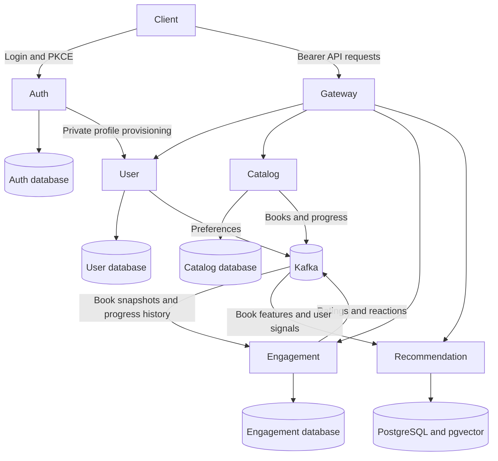

# VellumHub

> **A social reading platform with a recommendation read path designed to survive upstream outages.**
> Six Spring Boot services, Kafka-carried facts and local pgvector read models, with integration tests at Kafka and PostgreSQL boundaries.

[](https://openjdk.org/)
[](https://spring.io/projects/spring-boot)
[](https://kafka.apache.org/)
[](https://www.postgresql.org/)
[](https://github.com/pgvector/pgvector)
[](https://kubernetes.io/)
[](https://github.com/Luca5Eckert/VellumHub/actions/workflows/codeql.yml)

Users register, pick genres, discover books, build shared lists, track reading, rate and react — and get recommendations that learn from all of it. The engineering question behind it: **how do you serve personalised recommendations without calling three other services on every read?** VellumHub answers with event-carried state and local projections, and measures what that trade-off actually costs.

**Jump to:** [Results](#results) · [How it works](#how-it-works) · [Engineering highlights](#engineering-highlights) · [Run it](#run-it-locally) · [Verify it](#verify-it) · [Limits](#honest-limits) · [Docs](#documentation)

---

## Results

The table records the historical reference runs. The November audit repeats the read-autonomy and ranking measurements on a later SHA and documents the different latency observed. [Historical reference](https://github.com/Luca5Eckert/VellumHub/pull/287) · [November audit](tools/metrics/backend-audit-runs/2026-11-24/README.md)

| What was measured | Result |
| --- | ---: |
| Recommendation reads with User, Catalog **and** Engagement unavailable | **60 / 60 succeeded** |
| Rating → visible change in the user's ranking (90-event burst, p95) | **553–751 ms** |
| Interactions that produced the expected ranking change | **260 / 260** |
| Recommendation read latency after convergence (p95) | **15.98–19.86 ms** |
| Ranking quality, 70/30 semantic + popularity (nDCG@10, offline) | **0.599** vs **0.066** popularity-only |

The freshness run follows a `CreatedRatingEvent` from Kafka through the consumer, `user_profiles` and pgvector ranking until an authenticated `GET /recommendations` sees the expected book at rank #1. All numbers are controlled CI/Testcontainers and offline-evaluation evidence, not production SLAs; reproduce them with the [distributed benchmark](services/recommendation-service/benchmark/README.md) and the [offline evaluation](services/recommendation-service/evaluation/README.md).

## How it works



1. **Each service owns its data.** Five PostgreSQL databases with separate credentials, guarded by database-ownership checks; services share facts, never tables.
2. **Changes leave as facts, atomically.** Catalog and Engagement write the business change and an Outbox row in one transaction; a relay publishes to Kafka with lease-token fencing ([sequence](docs/architecture/flows/book-outbox.md) · [states](docs/architecture/states/outbox-delivery.md)).
3. **Consumers apply each revision once in effect.** A per-aggregate checkpoint, processed-event IDs and the projection commit together; duplicates are no-ops, gaps are rejected, and poison records are quarantined without breaking order ([sequence](docs/architecture/flows/ordered-consumer.md) · [quarantine states](docs/architecture/states/kafka-quarantine.md)).
4. **Recommendation answers from local state.** 384-dimension embeddings, pgvector retrieval and reranking over its own projections. The HNSW index is available, and the planner selects the access path. [Feedback flow](docs/architecture/flows/recommendation-feedback.md) · [Measured plans](tools/metrics/backend-audit-runs/2026-11-24/README.md#plano-sql-com-pgvectorhnsw)
5. **One identity authority.** Auth is the only issuer of RS256 `at+jwt` tokens (OIDC, PKCE, Google federation, Argon2id); every service verifies tokens locally and enforces scope, role and ownership ([authorization sequence](docs/architecture/flows/api-request-authorization.md)).

Every flow above is a code-backed diagram: browse them in the [architecture index](docs/architecture/README.md) or the [HTML explorer](docs/architecture/architecture-explorer.html).

| Service | Owns |
| --- | --- |
| [Auth](services/auth-service/README.md) | Identities, credentials, Google bindings, OAuth clients, sessions, signing keys and JWKS |
| [Gateway](services/gateway-service/README.md) | Routing, JWT verification, verified token relay, Redis rate limits, API discovery |
| [User](services/user-service/README.md) | Profiles and genre preferences |
| [Catalog](services/catalog-service/README.md) | Books, requests, covers, collaborative lists, reading progress |
| [Engagement](services/engagement-service/README.md) | Ratings, reactions, book snapshots, reading history |
| [Recommendation](services/recommendation-service/README.md) | Book features, user vectors, ranking and response cache |

## Engineering highlights

- **Reliability proven at real boundaries.** Testcontainers suites with real Kafka, PostgreSQL/pgvector and Schema Registry cover duplicate delivery, rollback, revision gaps, DLT quarantine and outbox fencing ([distributed testing](docs/DISTRIBUTED_TESTING.md)).
- **Architecture as executable rules.** ArchUnit (layering, module cycles), Maven Enforcer (service isolation), database-ownership and recovery-parity checks, with negative fixtures proving the rules can fail ([fitness functions](docs/ARCHITECTURE_FITNESS_FUNCTIONS.md)).
- **Contracts that evolve safely.** JSON and Avro contract libraries, Apicurio Registry with `BACKWARD_TRANSITIVE` subjects and no auto-registration, and a per-stream JSON → Avro cutover with rollback ([wire format states](docs/architecture/states/event-wire-format.md) · [schema evolution tests](docs/SCHEMA_EVOLUTION_TESTS.md)).
- **Security in depth.** Least-privilege Kafka principals and ACLs per service, OAuth scopes and roles per endpoint, ownership checks that answer 404 for hidden resources, and error bodies tested to never leak SQL, parser or user data ([scopes](docs/SECURITY_SCOPES_RBAC.md) · [Kafka identities](docs/KAFKA_SERVICE_IDENTITIES.md)).
- **Delivery you can audit.** Images are built and scanned once (Trivy, SBOM), the same bytes run a Kind cluster with OAuth and business journeys, and only then are published ([CI/CD](docs/CI_CD.md)).
- **Observable by default.** Prometheus, Loki, Tempo and Grafana with dashboards and alerts linked to runbooks ([observability](docs/OBSERVABILITY.md) · [runbooks](docs/OBSERVABILITY_RUNBOOKS.md)).

## Run it locally

Requirements: Docker with Compose, OpenSSL, and Java 21 + Maven only if you run checks outside containers.

```bash
cp .env.example .env          # set the five DB passwords, VELLUM_INTERNAL_PROVISION_KEY (32+ chars) and origins

# Auth signing key pair (Linux/WSL; the private key must be readable by UID 10001)
umask 077
install -d -m 755 .local/auth-keys
openssl genpkey -algorithm RSA -pkeyopt rsa_keygen_bits:3072 -out .local/auth-keys/signing-private.pem
openssl pkey -in .local/auth-keys/signing-private.pem -pubout -out .local/auth-keys/signing-public.pem
chmod 600 .local/auth-keys/signing-private.pem && chmod 644 .local/auth-keys/signing-public.pem
sudo chown 10001:10001 .local/auth-keys/signing-private.pem

docker compose up -d --build
```

| Entry point | URL |
| --- | --- |
| API Gateway | `http://localhost:8080` |
| Swagger UI (all services) | `http://localhost:8080/docs` |
| Auth discovery | `http://127.0.0.1:9000/.well-known/openid-configuration` |
| Kafka UI | `http://localhost:8090` |
| Grafana (with `--profile observability`) | `http://localhost:3002` |

Tokens come from Auth through a PKCE client; the default read workflow needs `user:read catalog:read engagement:read recommendation:read`. A contract-generated [Postman collection](postman/README.md) and `bash infra/scripts/security/run_oidc_lote2_e2e.sh` (a disposable end-to-end login exercise) help you try it. The [web client](frontend/README.md) uses the Gateway for onboarding, recommendations and reading actions. Layout and overlays: [infrastructure](docs/INFRASTRUCTURE_LAYOUT.md) · empty environment straight on Avro: [fresh Avro installation](docs/FRESH_AVRO_INSTALLATION.md).

## Verify it

```bash
./mvnw -B verify                                   # full reactor; Testcontainers suites need Docker
python3 tools/architecture/validate_docs.py        # architecture docs and diagrams
python3 -m unittest discover -s tools/architecture -p "test_*.py"
```

Pull requests also run distributed E2E, architecture fitness, contract and Postman drift checks, CodeQL, image scans and the Kind gate.

## Honest limits

- **Eventual consistency is the price of read autonomy.** A rating takes up to ~0.75 s (p95, measured) to reach the ranking.
- **The ranking weight is a tuning target.** On the synthetic offline set a semantic-only ablation scores 1.000 nDCG@10, so the 70/30 popularity weight is a documented heuristic, not an optimum.
- **Caches are opt-in.** Redis response caches help hot reads (Catalog warm, 32 concurrent: p95 44.89 → 10.35 ms) but slow cold ones (8 concurrent: 8.10 → 13.41 ms), so they stay off by default ([Catalog cache](docs/CATALOG_REDIS_CACHE.md) · [Recommendation cache](docs/RECOMMENDATION_REDIS_CACHE.md)).
- **No production deployment is claimed.** CI, Kind and benchmarks prove repository behaviour; live Google federation, managed Kafka/PostgreSQL and production SLAs need their own evidence.
- **At-least-once, not exactly-once.** Effects are idempotent on the canonical streams; legacy topics remain until their cutover.

## Documentation

| Need | Start here |
| --- | --- |
| Architecture, flows and state machines | [Architecture index](docs/architecture/README.md) · [Service registry](docs/architecture/services/README.md) |
| Security | [Authorization sequence](docs/architecture/flows/api-request-authorization.md) · [Google federation](docs/architecture/flows/google-federation.md) · [Identity states](docs/architecture/states/auth-identity-lifecycle.md) |
| Events and consistency | [Book events](docs/BOOK_EVENTS.md) · [Engagement events](docs/ENGAGEMENT_EVENTS.md) · [Consumer idempotency](docs/CONSUMER_IDEMPOTENCY.md) · [Kafka recovery](docs/KAFKA_RECOVERY_RUNBOOK.md) |
| API | [API documentation](docs/api-documentation.md) · [Postman](postman/README.md) |
| Operations and delivery | [Operations](docs/OPERATIONS.md) · [Kubernetes](deploy/kubernetes/README.md) · [CI/CD](docs/CI_CD.md) |
| Backend engineering evidence | [Audit and professional evidence](tools/metrics/backend-engineering-audit.md) · [Benchmarks and reproduction](tools/metrics/README.md) |
| Offline training data | [`training/`](training/README.md) exports versioned books, user signals and a hashed manifest |

The engineering Vault keeps decision history and alternatives. This repository documents the current code and retains SHA-bound evidence for audited runs.
