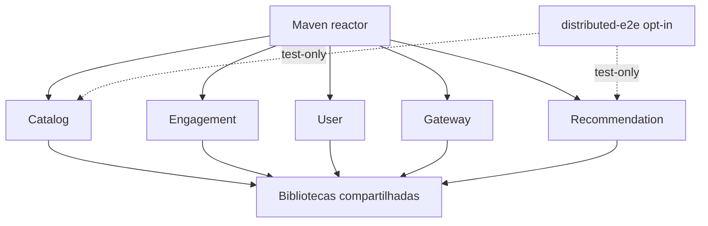

# Architecture Fitness Functions — execução e evidências

> Incremento implementado nesta branch: **AFF-BOUND-003 (dependências Maven declaradas)**. AFF-STR-001/002 e AFF-EVT-005/006/007, AFF-CON-008, AFF-DATA-004 continuam pendentes. Não inferir CI verde sem execução.

## Dependências — diagrama



### Gate AFF-BOUND-003

Executar na raiz:

```bash
python -m unittest discover -s tools/architecture -p 'test_*.py' -v
python tools/architecture/check_service_boundaries.py
```

O checker lê o reactor Maven e todos os nós `dependency` dos POMs dos cinco serviços, inclusive dentro de profiles. Rejeita declarações service -> service e POMs de serviços ausentes. A suíte contém fixtures que precisam falhar com dependências proibidas, e uma fixture de biblioteca compartilhada permitida. CI: `.github/workflows/architecture-fitness.yml`.

**Limitação explícita:** o checker cobre dependências declaradas no POM local, não resolve dependências transitivas, parents externos, bytecode ou ciclos de módulos internos. AFF-BOUND-003 está implementada parcialmente; completar a inspeção do grafo Maven efetivo antes de marcar ENFORCED na fonte normativa.

## Outbox — modelo de falhas e testes ainda necessários

```mermaid
sequenceDiagram
  participant S as Domain service
  participant DB as PostgreSQL
  participant P as Outbox publisher
  participant K as Kafka
  participant C as Consumer
  S->>DB: BEGIN; mutate aggregate; insert outbox
  alt insert fails
    DB-->>S: ROLLBACK both
  else committed
    DB-->>S: COMMIT
    P->>K: Publish event
    K-->>P: ACK
    Note over P: Crash before published marker: republish possible
    K->>C: Event or redelivery
    C->>DB: Projection + checkpoint in single transaction
  end
```

A suíte AFF-EVT-005 precisa provar rollback de negócio quando falha a Outbox, retenção do evento quando Kafka falha e segurança de recuperação do publisher. AFF-EVT-006 exige reentrega real, falhas antes e depois de commit e verificação de que a projeção persiste efeitos únicos. AFF-EVT-007 testa gaps por stream; AFF-CON-008 exige fixtures imutáveis de versões suportadas. Reutilizar os testes existentes descritos em `docs/DISTRIBUTED_TESTING.md`; não afirmar exactly-once global.

## Rastreabilidade

| Rule | Estado | Evidência |
| --- | --- | --- |
| AFF-BOUND-003 (declared) | Implementado, pendente de CI | tools/architecture e workflow |
| AFF-BOUND-003 (transitive) | Pendente | dependency graph efetivo |
| AFF-STR-001/002 | Pendente | ArchUnit por packages reais |
| AFF-EVT-005/006/007 | Pendente | Testcontainers Kafka/PostgreSQL |
| AFF-CON-008 / AFF-DATA-004 | Pendente | fixtures e ownership tests |

Não alterar status normativo para ENFORCED até testes e CI reproduzíveis, com SHA e resultados.
