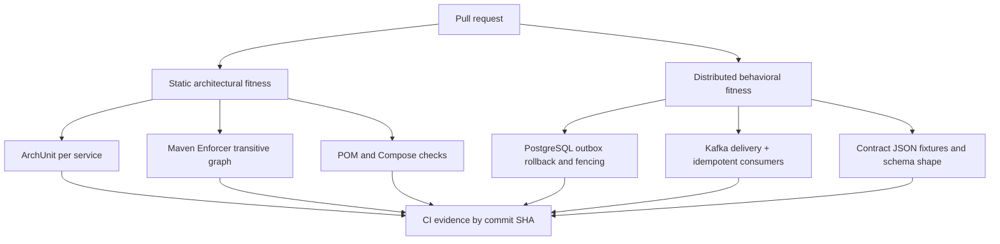
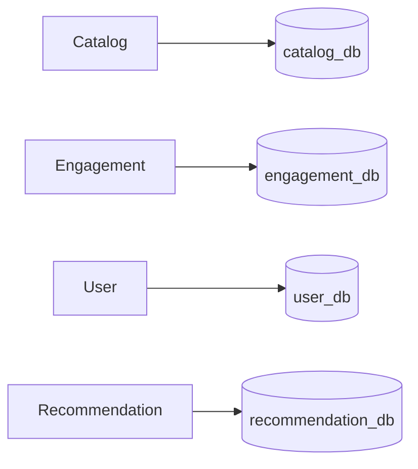

# Architecture Fitness Functions — implementation and evidence

> Issues [#323](https://github.com/Luca5Eckert/VellumHub/issues/323) and [#324](https://github.com/Luca5Eckert/VellumHub/issues/324). **Implementation in progress.** Do not claim enforced status for a rule until its actual tests have passed and CI evidence is attached.

## System topology and test layers



## Executable verification

```bash
python -m unittest discover -s tools/architecture -p 'test_*.py' -v
python tools/architecture/check_service_boundaries.py
python tools/architecture/check_database_ownership.py
mvn -B verify
# opt-in distributed reactor (requires Docker)
mvn -B -Pdistributed-e2e verify
```

The default reactor has five deployable services and three shared libraries; `integration-tests/distributed-e2e` remains opt-in. The Python static checks have negative fixtures and a GitHub Actions workflow. The Maven Enforcer plugin in all five service POMs resolves and checks transitive dependencies at `validate`; only deployable-to-deployable artifacts are banned. Shared `lib/kafka-contracts` and test support remain available.

### AFF-STR-001 and AFF-STR-002

ArchUnit is test-scoped in all five modules. The domain boundary rule prohibits domain -> infrastructure/adapter/controller dependencies. The module rule checks slice cycles. Non-applicable package layouts use JUnit assumptions, so skipped tests do not claim coverage. Catalog also includes negative fixtures for forbidden dependencies and cycles.

A real historical cycle `book -> book_request -> book` was discovered by CI and the Book handlers were refactored to use their own domain exception instead of an exception from BookRequest. This changes the exception type for invalid genres, while preserving existing BookDomainException handling.

### AFF-BOUND-003 and AFF-DATA-004



The Compose ownership checker confirms distinct PostgreSQL endpoints and declared database names. **It does not prove credentials, network ACLs, or database authorization isolation**: local Compose currently uses shared POSTGRES_USER and POSTGRES_PASSWORD values across database instances. Remediation and negative authorization tests remain pending before AFF-DATA-004 can be enforced.

### AFF-EVT-005 to AFF-EVT-007

```mermaid
sequenceDiagram
  participant A as Aggregate service
  participant DB as PostgreSQL
  participant P as Outbox dispatcher
  participant K as Kafka
  participant C as Consumer
  A->>DB: business mutation + outbox append (one transaction)
  alt outbox insert fails
    DB-->>A: rollback business mutation
  else committed
    DB-->>A: commit
    P->>K: publish
    K-->>P: ACK
    alt PUBLISHED marking fails
      Note over P,DB: Event remains IN_FLIGHT; lease may expire
      P->>DB: reclaim with new fencing token
      P->>K: republish same event ID
    end
    K->>C: deliver/redeliver
    C->>DB: projection + checkpoint atomically
  end
```

New test scenarios added to the existing suites:

- Catalog and Engagement: Outbox insert constraint failure rolls back simultaneous domain writes.
- Catalog: transport timeout injected after durable append, retry state preserved in real PostgreSQL; healthy production Kafka transport publishes the original event ID after recovery. This simulates broker unavailability at the transport boundary, not an actual network partition of the Kafka container.
- Catalog: lease expiration and stale claim token prevent obsolete ACKs from marking an event published.
- Catalog Kafka/PostgreSQL: ACK received, PUBLISHED marking deliberately fails, recovery republishes same event ID.
- Recommendation: tests for Book/ReadingProgress revision gaps against persistent checkpoints.
- Existing Recommendation distributed idempotency tests are labeled as AFF-EVT-006 and retain real Kafka/PostgreSQL coverage.

Remaining proof obligations include exhaustive consumer/stream coverage, Kafka broker unavailability after business commit, consumer crash windows, and complete DLT/recovery boundaries. At-least-once delivery is expected; **no globally exactly-once claim**.

### AFF-CON-008

The `lib/kafka-contracts` test suite now checks a frozen field/type baseline for the canonical Book, Rating, Reaction and ReadingProgress records and reads four versioned JSON payloads including a legacy Reaction fixture. Existing service integration tests prove Kafka `__TypeId__` headers. Compatibility outside explicitly captured fixture versions is not proven.

## Evidence matrix

| Rule | Test/code location | Status pending full CI |
| --- | --- | --- |
| STR-001/STR-002 | `services/*/src/test/java/**/architecture` | Implemented; verify all modules and historical violations |
| BOUND-003 | Maven Enforcer + `tools/architecture/check_service_boundaries.py` | Static workflow passing; full reactor verification pending |
| DATA-004 | `tools/architecture/check_database_ownership.py` | Configuration only; credentials not isolated |
| EVT-005 | Catalog/Engagement PostgreSQL tests, Catalog Kafka ack test | CI Testcontainers verification pending |
| EVT-006 | Recommendation `ConsumerIdempotencyDistributedTest` | Partial scenarios; full matrix pending |
| EVT-007 | Recommendation revision-gap cases, Outbox fencing | Partial scenarios; full matrix pending |
| CON-008 | `lib/kafka-contracts/src/test` and fixtures | JSON fixtures added; CI verification pending |

## Operational status

Latest confirmed static boundary workflow passed at commit `e6b1655f981f8e4dab51f25ffb29b4afb421bb98`; Recommendation benchmark passed for the same commit. An earlier general Maven verify run was unsuccessful and the log could not be retrieved in full through the connector because it exceeded its size limit. Do not merge solely on isolated workflow successes. Record the final PR run URL, commit SHA, test summary and any known limitations before changing statuses in the Obsidian source of truth.
