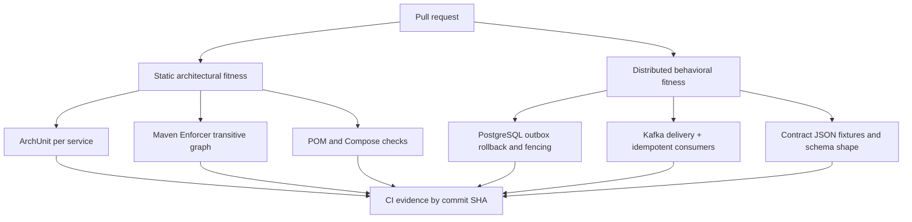
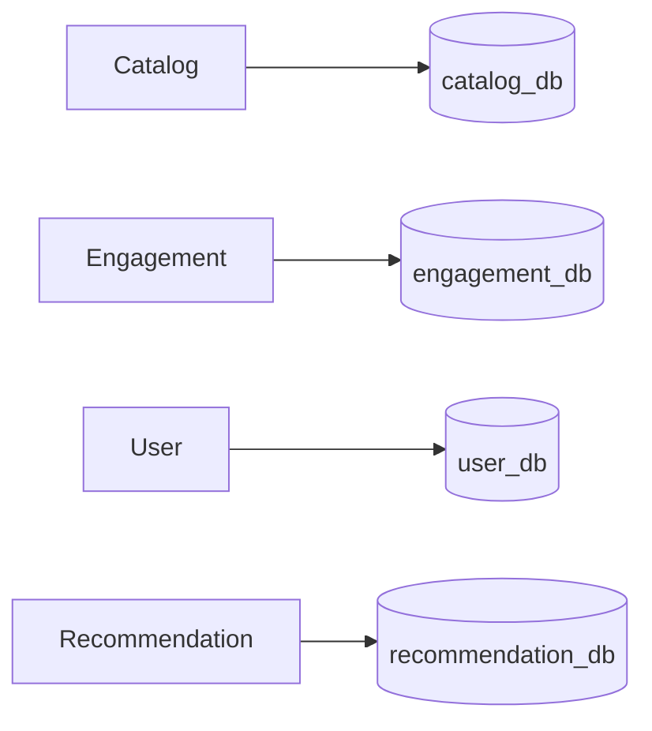

# Architecture Fitness Functions — implementation and evidence

> AFF-01/#323 and AFF-02/#324 were merged through PR #326. AFF-03/#325 extends the evidence pipeline on its own branch. Maturity never implies a suite ran in a particular CI job.

## System topology and test layers



## Executable verification

```bash
python -m unittest discover -s tools/architecture -p 'test_*.py' -v
python tools/architecture/check_service_boundaries.py
python tools/architecture/check_database_ownership.py
mvn -B verify
# opt-in distributed reactor (requires Docker)
mvn -B -Pdistributed-e2e verify
```

The default reactor has six deployable services and three shared libraries; `integration-tests/distributed-e2e` remains opt-in. The Python static checks have negative fixtures and a GitHub Actions workflow. The Maven Enforcer plugin in the five domain/gateway service POMs resolves and checks transitive dependencies at `validate`; only deployable-to-deployable artifacts are banned. Shared `lib/kafka-contracts` and test support remain available.

### AFF-STR-001 and AFF-STR-002

ArchUnit remains test-scoped in the five domain/gateway modules; Auth is covered by the deployable dependency and database-ownership checks. The domain boundary rule prohibits domain -> infrastructure/adapter/controller dependencies. The module rule checks slice cycles. Non-applicable package layouts use JUnit assumptions, so skipped tests do not claim coverage. Catalog also includes negative fixtures for forbidden dependencies and cycles.

A real historical cycle `book -> book_request -> book` was discovered by CI and the Book handlers were refactored to use their own domain exception instead of an exception from BookRequest. This changes the exception type for invalid genres, while preserving existing BookDomainException handling.

### AFF-BOUND-003 and AFF-DATA-004



The Compose ownership checker confirms distinct PostgreSQL endpoints and declared database names. **It does not prove credentials, network ACLs, or database authorization isolation**: local Compose currently uses shared POSTGRES_USER and POSTGRES_PASSWORD values across database instances. A real PostgreSQL negative authorization fixture (`DatabaseOwnershipPostgresFitnessTest`) now verifies a restricted Catalog role can query its own schema but receives SQLSTATE 42501 when reading an Engagement schema. **This is a role-model test, not proof that Compose/deployment credentials are currently isolated.** Local Compose now requires domain-specific POSTGRES_<DOMAIN>_USER/PASSWORD keys for each application and corresponding PostgreSQL container. A negative static test rejects shared variables. Existing database volumes must be migrated separately because POSTGRES_USER/PASSWORD only initialize empty databases. This verifies Compose wiring and a separate PostgreSQL privilege fixture; deployment secrets, live credentials and network ACLs are still not proven.

### AFF-EVT-005 to AFF-EVT-007

```mermaid
sequenceDiagram
  participant A as Aggregate service
  participant DB as PostgreSQL
  participant P as Outbox dispatcher
  participant K as Kafka
  participant C as Consumer
  A->>DB: business mutation + outbox append (one transaction)
  alt outbox insert fails
    DB-->>A: rollback business mutation
  else committed
    DB-->>A: commit
    P->>K: publish
    K-->>P: ACK
    alt PUBLISHED marking fails
      Note over P,DB: Event remains IN_FLIGHT; lease may expire
      P->>DB: reclaim with new fencing token
      P->>K: republish same event ID
    end
    K->>C: deliver/redeliver
    C->>DB: projection + checkpoint atomically
  end
```

New test scenarios added to the existing suites:

- Catalog and Engagement: Outbox insert constraint failure rolls back simultaneous domain writes.
- Catalog: transport timeout injected after durable append, retry state preserved in real PostgreSQL; healthy production Kafka transport publishes the original event ID after recovery. This simulates broker unavailability at the transport boundary, not an actual network partition of the Kafka container.
- Catalog: lease expiration and stale claim token prevent obsolete ACKs from marking an event published.
- Catalog Kafka/PostgreSQL: ACK received, PUBLISHED marking deliberately fails, recovery republishes same event ID.
- Recommendation: tests for Book/ReadingProgress revision gaps against persistent checkpoints.
- Recommendation: Rating revision-gap regression fixture now asserts unchanged projection, uncommitted event identity, retained offset and eventual application of revision N+1 after N.
- Existing Recommendation distributed idempotency tests are labeled as AFF-EVT-006 and retain real Kafka/PostgreSQL coverage.

Remaining proof obligations include exhaustive consumer/stream coverage, Kafka broker unavailability after business commit, consumer crash windows, and complete DLT/recovery boundaries. At-least-once delivery is expected; **no globally exactly-once claim**.

### AFF-CON-008

The `lib/kafka-contracts` test suite now checks a frozen field/type baseline for the canonical Book, Rating, Reaction and ReadingProgress records and reads four versioned JSON payloads including a legacy Reaction fixture. Existing service integration tests prove Kafka `__TypeId__` headers. Compatibility outside explicitly captured fixture versions is not proven.

## Evidence matrix

| Rule | Test/code location | Status pending full CI |
| --- | --- | --- |
| STR-001/STR-002 | `services/*/src/test/java/**/architecture` | Implemented; verify all modules and historical violations |
| BOUND-003 | Maven Enforcer + `tools/architecture/check_service_boundaries.py` | Static workflow passing; full reactor verification pending |
| DATA-004 | `tools/architecture/check_database_ownership.py` | Configuration only; credentials not isolated |
| EVT-005 | Catalog/Engagement PostgreSQL tests, Catalog Kafka ack test | CI Testcontainers verification pending |
| EVT-006 | Recommendation `ConsumerIdempotencyDistributedTest` | Partial scenarios; full matrix pending |
| EVT-007 | Recommendation revision-gap cases, Outbox fencing | Partial scenarios; full matrix pending |
| CON-008 | `lib/kafka-contracts/src/test` and fixtures | JSON fixtures added; CI verification pending |

## Operational status

Latest confirmed static boundary workflow passed at commit `e6b1655f981f8e4dab51f25ffb29b4afb421bb98`; Recommendation benchmark passed for the same commit. An earlier general Maven verify run was unsuccessful and the log could not be retrieved in full through the connector because it exceeded its size limit. Do not merge solely on isolated workflow successes. Record the final PR run URL, commit SHA, test summary and any known limitations before changing statuses in the Obsidian source of truth.

## Canonical stream failure coverage matrix (AFF-02)

| Property | Book | BookProgress | Rating | Reaction |
| --- | --- | --- | --- | --- |
| Outbox atomic rollback | Catalog Postgres | Catalog service: existing domain tests; gap in explicit injected rollback fixture | Engagement Postgres | Engagement: inspect corresponding producer fixture |
| Kafka publish and recovery | Catalog Kafka outbox replay and injected timeout | Producer retry not individually established by this suite | Engagement publisher retry with PostgreSQL, Kafka failure unverified | Engagement publisher retry with PostgreSQL, Kafka failure unverified |
| Consumer idempotency | Recommendation Book duplicate + checkpoint | Recommendation duplicate + checkpoint | Recommendation Kafka re-delivery + profile | Existing processor tests; repeat delivery scenario pending |
| Out-of-order revision | Recommendation PostgreSQL gap | Recommendation PostgreSQL gap | Recommendation PostgreSQL gap and subsequent catchup | Recommendation PostgreSQL gap |
| Wire backward compatibility | Book fixture | ReadingProgress fixture | Rating fixture | Reaction legacy fixture |

**Interpretation**: a test against one type is not evidence of coverage for all streams. Existing E2E Catalog producer -> Recommendation projection proves one full pipeline, not an all-stream guarantee. Kafka ACK after database commit can be ambiguous and physical duplicates remain valid under at-least-once delivery. For each future stream, add test evidence before changing this matrix. The Reaction/Ratings revision-gap tests use real PostgreSQL in the Recommendation distributed harness.

### CI evidence by commit

- Baseline `c9a2bb75e822defb03408970f6d7abdddabe45dc`: [Maven and distributed verify](https://github.com/Luca5Eckert/VellumHub/actions/runs/39614547962) and [static architecture / wire fixtures](https://github.com/Luca5Eckert/VellumHub/actions/runs/39614548517) passed.
- `beedacd785b6a1d53d77564036e247da2a172ee0`: distributed run failed: Reaction test used invalid enum `LIKE` (runtime supports `POSITIVE`, `NEGATIVE`, `VERY_POSITIVE`).
- `4c2eadb56a1fbce584e44de84f247db9531bb05a`: test corrected; result must be checked at [PR #326](https://github.com/Luca5Eckert/VellumHub/pull/326). Passing on an earlier SHA is not passing on this commit.

## Architecture fitness review / Definition of Done

- **STR-001/002:** Five service-local ArchUnit suites; Catalog negative bytecode fixtures.
- **BOUND-003:** Python reactor checker plus Maven Enforcer transitive ban, with explicit
  contract/test support exceptions and an opt-in E2E module.
- **DATA-004:** Compose enforces distinct per-domain environment variable keys and endpoint
  wiring; a PostgreSQL Testcontainers negative privilege fixture proves SQLSTATE 42501.
  Persistent Docker volumes need a deliberate role migration before local rollout.
- **EVT-005:** Producer-side PostgreSQL rollback test coverage for Book, BookProgress,
  Rating and Reaction; Catalog publisher tests prove ACK/mark ambiguity, fenced lease
  reclaim and injected transport timeout followed by real Kafka recovery.
- **EVT-006:** Recommendation PostgreSQL checkpoints and projection idempotence for Book,
  BookProgress, Rating and Reaction, including a forced checkpoint failure after a
  Rating profile update and subsequent retry.
- **EVT-007:** Per-stream revision gap checks for Book, BookProgress, Rating and Reaction.
- **CON-008:** Frozen JSON fixtures and schema tests in Kafka contracts; actual Kafka
  type-header verification in distributed service tests.

Evidence is bounded to **tested code paths**. The older legacy Reaction topic
does not have stable event IDs or revisions and cannot be made canonically
idempotent without a migration. Universal DLT replay and deployment-specific
network policies are independent concerns and are **not** asserted by these
fitness functions. See `docs/REACTION_EVENT_CONTRACTS.md` and issue #272.

All CI claims must cite the exact run and commit. Passing earlier commits does
not validate the latest branch HEAD; leave this record as implementation evidence
until the PR checks finish.

## AFF-03: Read autonomy, convergence and evidence

- **AFF-REC-009** — the #283 distributed Recommendation benchmark creates books by real Kafka events, materializes user profiles, and asserts authenticated GET responses contain only expected local projection IDs and titles. A loopback HTTP-503 canary records all calls to the configured test User/Catalog/Engagement endpoints: even swallowed failures increment the count, and **zero** calls is an invariant. A Recommendation serving-path ArchUnit test blocks known synchronous HTTP client dependencies. The canary is bounded to configured endpoints; extending the stack requires extending the instrumented coverage. New upstream events are not guaranteed during producer failure.
- **AFF-OPS-010** — the benchmark retains separate measurements for event-to-projection (publish to local row observed) and event-to-visible-ranking (publish to first authenticated ranking change). Raw events, seed, warmups, environment and commit metadata remain under the existing #283 report directory. Reference p50/p95/p99 and throughput are **not** gates on hosted runner hardware; smoke gates only semantic invariants.
- **AFF-RES-011** — per-flow degradation is catalogued against existing outbox, retry/DLT, revision-gap and checkpoint behavior. Replay and quarantine claims require their own tested evidence. No universal replay or global exactly-once claim.

### Catalog and CI execution evidence

The executable index is `tools/architecture/fitness-catalog.json` (AFF-STR-001 through AFF-RES-011). Each record has an owner, ADR, scope, expected suites, command, maturity, baseline, exceptions, cadence, cost and limitations. Statuses: PROPOSED = only proposed; BASELINE = inventory/coverage assessed without an enforced complete rule; ENFORCED = rule is an effective regression gate with prior evidence; MONITORED = measured/reference behavior (without unconditional performance threshold). Maturity is not a per-run result.

`tools/architecture/generate_evidence.py` gathers executed Maven Surefire XML, actually runs the Python structural negative fixtures when `--run-static` is passed, and validates the benchmark raw JSON. It emits `target/architecture-evidence/fitness-evidence.json` and `fitness-evidence.md` tagged with workflow run ID and full HEAD SHA, with distinct PASS/FAIL/SKIPPED/NOT_RUN. Required gates fail if their suites or raw evidence are absent. Results of separate jobs are separate artifacts; **never** claim an aggregated green status merely because another job or previous commit passed.

```bash
python3 tools/architecture/generate_evidence.py --run-static --profile static --require AFF-BOUND-003 --require AFF-DATA-004
python3 -m unittest discover -s tools/architecture -p 'test_*.py' -v
# After actually running the benchmark's two distinct Maven processes:
python3 tools/architecture/generate_evidence.py --profile smoke --sha <benchmark-commit-sha> \
  --benchmark-dir services/recommendation-service/target/distributed-benchmark/smoke \
  --require AFF-REC-009 --require AFF-OPS-010
```

Workflows now upload per-SHA evidence from static, ArchUnit, wire contracts, reactor, distributed behavior and benchmark jobs. They do not restart expensive distributed suites just to create a report. Each failing AFF includes the decision, test, failure and correction guide. An intentional outbound call and an incompatible/absent projection must make the smoke fail; variable p95 alone must not.

### Maintenance and baseline changes

If a new flow cannot maintain read autonomy, document the scoped exception and the affected ADR **before** relaxing the gate. Add fixture tests for each newly supported client/upstream. Re-run the exact suites on the PR HEAD and record the GitHub Actions artifact URL and commit; evidence from a different SHA cannot validate that change. Do not upgrade maturity based on tests not executed, do not introduce a new fitness service, and separate local test evidence from a production rollout.
