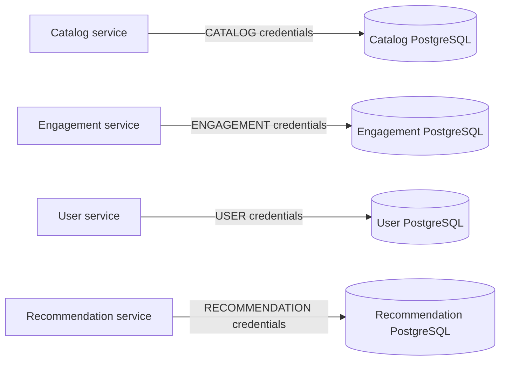

# Local Compose database credential migration (AFF-DATA-004)

Each PostgreSQL instance now uses a separate `POSTGRES_<DOMAIN>_USER` and `POSTGRES_<DOMAIN>_PASSWORD` pair for CATALOG, ENGAGEMENT, USER, and RECOMMENDATION. The app and its database must use identical values, but no two domains should reuse credentials.

## Existing installations

**Do not delete volumes to apply this change.** PostgreSQL's `POSTGRES_USER` and `POSTGRES_PASSWORD` variables only take effect on first initialization; editing `.env` will **not** change stored database roles or passwords.

1. Back up all four databases and record restoration procedures.
2. For each instance, connect using the current administrative credentials and create the new domain-specific role or rename/update the existing role as appropriate, retaining ownership and Flyway permissions for that database. Validate grants, extensions, and role membership in a staging copy.
3. Update the local `.env` with four **independent** secret values. Keep the file out of version control.
4. Restart the affected services, verify migration startup and application health, and test that stale credentials no longer authenticate.
5. Remove obsolete roles/credentials only after backup/rollback and all consumers have migrated.

Fresh installations can simply provide the eight required variables in `.env` before starting Compose. Docker Compose interpolation will fail early for missing values. This change does not claim production policy enforcement, nor does it address application superuser privileges on its own.

## Architecture

Run `python -m unittest discover -s tools/architecture -p 'test_*.py' -v` and `python tools/architecture/check_database_ownership.py` before rollout.
