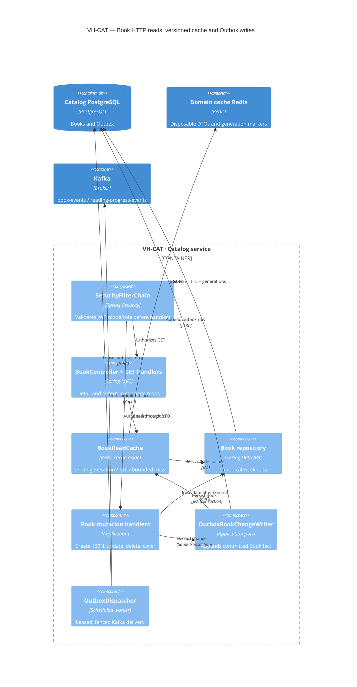

# C4 L3 — Catalog read cache and canonical write components

The Catalog component boundary distinguishes a **read optimization** (Redis DTO cache) from the **canonical write path** (Book aggregate + PostgreSQL Outbox). Versioned cache generations are bumped **after commit**; Kafka is not a prerequisite for an HTTP write transaction to commit.

**Clarification:** the component layout summarizes interactions; actual mutation handlers may invoke the domain `BookChangeWriter` abstraction rather than calling `OutboxBookChangeWriter` directly. The cache implements `BookCacheInvalidationPort`, which the writer depends on (no application → infrastructure import). The after-commit callback does not roll back a Book mutation when Redis fails. A stale in-flight request may return an older snapshot; the generation token prevents stale fills from populating a **new** generation.

| Invariant | Implementation / evidence |
| --- | --- |
| JWT before cache | [SecurityConfig](../../../services/catalog-service/src/main/java/com/vellumhub/catalog_service/share/security/SecurityConfig.java) |
| Stable pagination | [GetAllBooksHandler](../../../services/catalog-service/src/main/java/com/vellumhub/catalog_service/module/book/application/handler/get/GetAllBooksHandler.java) |
| Cache and bulkhead | [BookReadCache](../../../services/catalog-service/src/main/java/com/vellumhub/catalog_service/module/book/infrastructure/cache/BookReadCache.java) |
| Outbox transaction | [OutboxBookChangeWriter](../../../services/catalog-service/src/main/java/com/vellumhub/catalog_service/module/book/application/event/OutboxBookChangeWriter.java) |
| Delivery statuses | [JdbcOutboxStore](../../../services/catalog-service/src/main/java/com/vellumhub/catalog_service/module/outbox/infrastructure/persistence/JdbcOutboxStore.java) |
| Cache hardening | [Runbook](../../CATALOG_REDIS_CACHE.md) |

Detailed flows: [cache sequence](../flows/catalog-cache.md) · [Book Outbox](../flows/book-outbox.md) · [Outbox states](../states/outbox-delivery.md).
