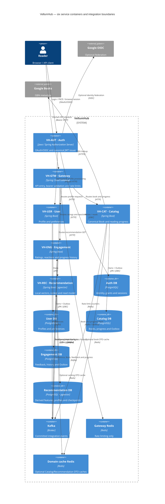

# C4 L2 — Backend containers and owned data

**Implemented topology, not a production deployment map.** Five logical PostgreSQL databases remain private to their owners (Auth, User, Catalog, Engagement and Recommendation). Kafka carries integration facts. Gateway rate limiting and domain response caching use **different Redis instances**; local Catalog and Recommendation share one disposable domain-cache Redis with separate key namespaces.

## Boundary checklist

| Rule | Code-backed interpretation |
| --- | --- |
| Identity issuer | [VH-AUT](../services/auth.md) is sole token issuer; Gateway and domain services verify bearer locally |
| Database ownership | No service directly joins a different service's application PostgreSQL tables |
| Recommendation autonomy | [VH-REC](../services/recommendation.md) serves from its own projection; no synchronous User/Catalog/Engagement lookup on GET |
| Eventual consistency | Canonical facts are persisted with Outbox and delivered through Kafka; a successful producer response does **not** mean all projections converged |
| Redis isolation | Gateway limiter Redis is distinct from local domain DTO cache Redis; DB remains source of truth |
| Environment | Local Compose/Kind cache flags ON; prod overlay OFF until provisioned and verified |

Follow deeper: [Catalog C4 L3](c4-catalog-components.md) · [Book event sequence](../flows/book-outbox.md) · [Recommendation sequence](../flows/recommendation-feedback.md) · [Service codes](../services/README.md).
