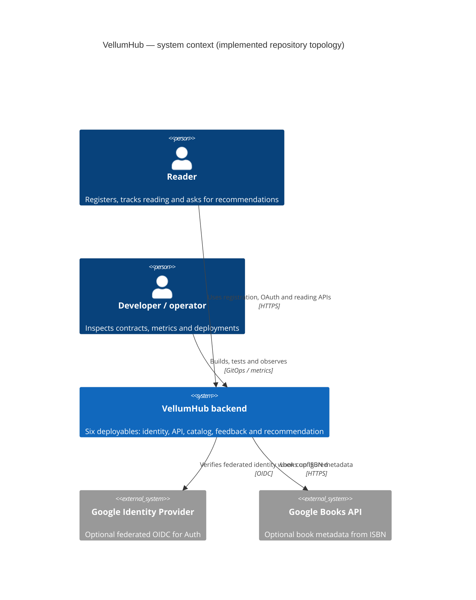

# C4 L1 — System context

The system boundary includes the six VellumHub backend deployables. The reader signs in through **Auth**, then accesses domain APIs via **Gateway**. Google is an optional upstream OIDC provider; Google Books provides external ISBN metadata. These are external systems, not additional VellumHub databases.

| Actor or external system | Trust boundary | Source |
| --- | --- | --- |
| Reader | Browser/API requests require valid auth and appropriate scopes | [OAuth policy](../../SECURITY_SCOPES_RBAC.md) |
| Google Identity Provider | Auth federates; Google tokens are **not** downstream API bearer tokens | [Auth card](../services/auth.md) |
| Google Books | Catalog reads external metadata for ISBN import | [Catalog card](../services/catalog.md) |
| Developer/operator | GitHub CI and local/Kind are not production rollout evidence | [Deployment](../../../deploy/kubernetes/README.md) |

Next: [C4 L2 — containers](c4-containers.md) · [Service catalog](../services/README.md) · [Architecture index](../README.md).
