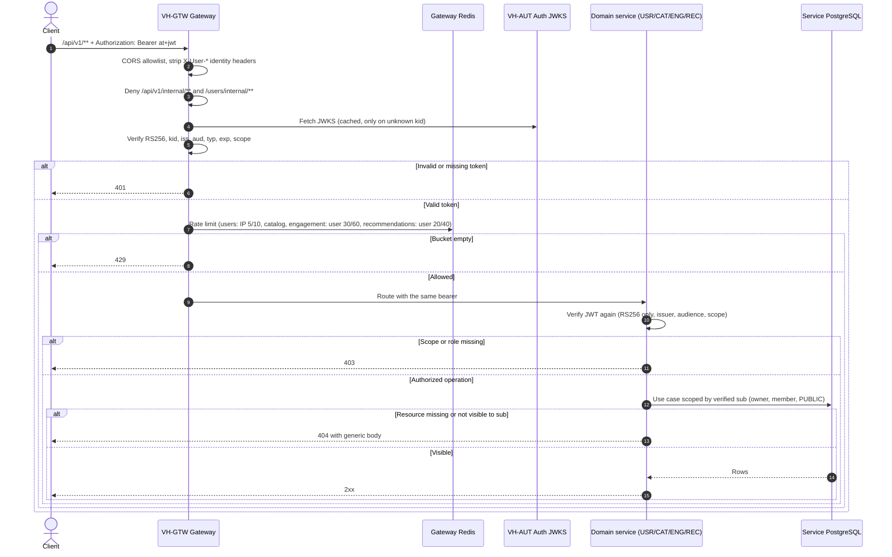

# Sequence — authenticated API request (Gateway → Resource Server)

Auth is the only issuer of RS256 `at+jwt` access tokens. The Gateway and every domain service verify the token **independently** against the Auth JWKS; no request path calls Auth or User to validate a bearer. Scopes and roles allow an operation; **ownership** is decided inside the use case from the verified `sub`.

| Rule | Where it is enforced |
| --- | --- |
| Token validation (RS256, `kid`, issuer, audience, `typ=at+jwt`) | [`lib/jwt-security`](../../../lib/jwt-security/src/main/java/com/vellumhub/security/jwt/JwtAccessToken.java) and each service `SecurityConfig` |
| Scopes per route (`catalog:read`, `catalog:write`, `engagement:*`, `user:*`) | [OAuthScopes](../../../lib/jwt-security/src/main/java/com/vellumhub/security/jwt/OAuthScopes.java) · [scope/RBAC matrix](../../SECURITY_SCOPES_RBAC.md) |
| Header stripping and internal-route denial | [UntrustedIdentityHeadersFilter](../../../services/gateway-service/src/main/java/com/vellumhub/gateway_service/config/security/UntrustedIdentityHeadersFilter.java) · [GatewaySecurityConfig](../../../services/gateway-service/src/main/java/com/vellumhub/gateway_service/config/security/GatewaySecurityConfig.java) |
| Rate limits and client key | [application.yml](../../../services/gateway-service/src/main/resources/application.yml) · [RateLimiterConfig](../../../services/gateway-service/src/main/java/com/vellumhub/gateway_service/config/rate/RateLimiterConfig.java) (`VELLUM_TRUSTED_PROXY_CIDRS` empty ⇒ TCP peer) |
| Book lists: PUBLIC, owner or member; private lists hidden as 404 | [BookList](../../../services/catalog-service/src/main/java/com/vellumhub/catalog_service/module/book_list/domain/model/BookList.java) · [BookListSpecificationProvider](../../../services/catalog-service/src/main/java/com/vellumhub/catalog_service/module/book_list/infrastructure/persistence/specification/BookListSpecificationProvider.java) |
| Ratings/reactions: owner only, foreign or missing ⇒ identical 404 | Engagement `GlobalExceptionHandler` (`handlePrivateResourceHidden`) |
| Recommendations: no client-chosen user ID | Recommendation controller and read use case use the principal |
| Error bodies never carry SQL, constraint or parser text | `GlobalExceptionHandler` in each service · `GlobalExceptionHandlerLeakTest` |

**Signing key:** Auth loads one RSA key pair (≥ 2048 bits, configured `kid`) and publishes it through JWKS; key rotation is not implemented. **Logout** does not revoke issued API tokens; they stay valid until `exp`. Documentation (`VELLUM_DOCS_ENABLED`) and Actuator endpoints must stay off public ingress.
