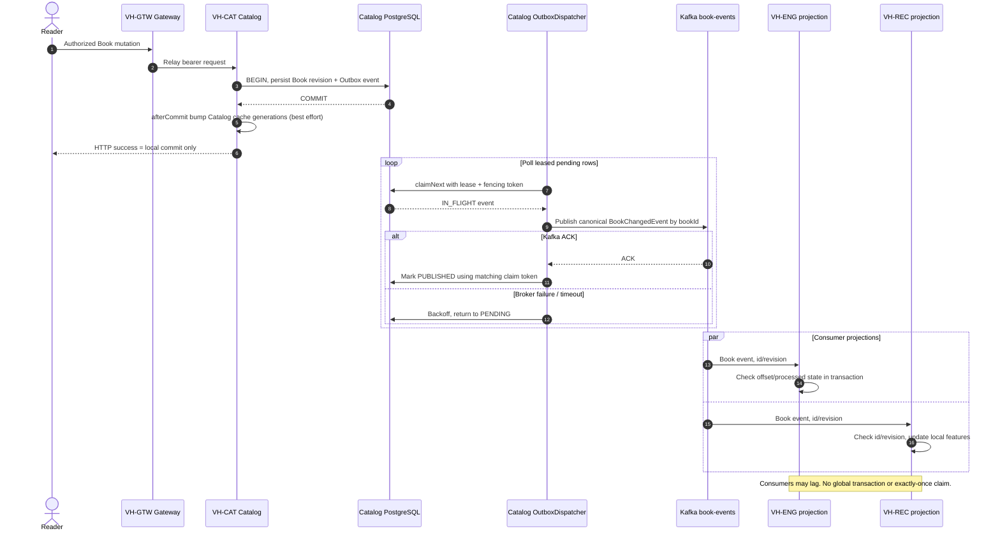

# Sequence — Book write, Outbox relay, asynchronous projections

**Outbox state machine:** [PENDING → IN_FLIGHT → PUBLISHED](../states/outbox-delivery.md). **Canonical contract:** [Book events](../../BOOK_EVENTS.md) · [Idempotent consumer checkpoints](../../CONSUMER_IDEMPOTENCY.md). **Code:** [writer](../../../services/catalog-service/src/main/java/com/vellumhub/catalog_service/module/outbox/infrastructure/persistence/JdbcOutboxWriter.java), [store](../../../services/catalog-service/src/main/java/com/vellumhub/catalog_service/module/outbox/infrastructure/persistence/JdbcOutboxStore.java) and [dispatcher](../../../services/catalog-service/src/main/java/com/vellumhub/catalog_service/module/outbox/infrastructure/dispatcher/OutboxDispatcher.java).

No event sourcing is implied: Book is canonical in PostgreSQL and the Outbox stores delivery facts. Kafka is asynchronous and legacy topics may still exist during cutover.
