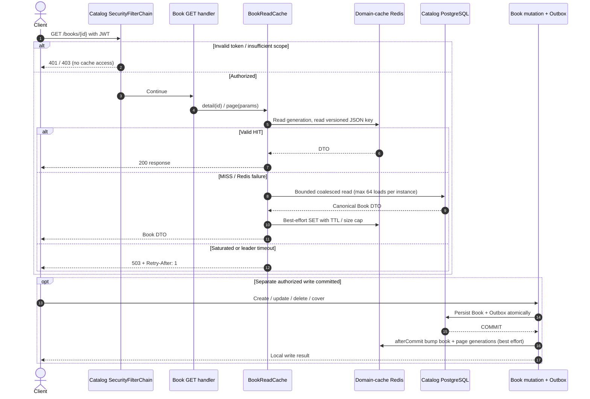

# Sequence — Catalog cache-aside and after-commit invalidation

JWT authorization occurs before any Redis cache lookup. Cache data is disposable JSON DTO; PostgreSQL remains canonical. Generation keys isolate new readers from an older in-flight fill; they do **not** guarantee linearizable responses for requests already executing.

**Config and capacity:** [Catalog Redis runbook](../../CATALOG_REDIS_CACHE.md). In local Compose/Kind both read and invalidation flags are ON; production flags remain OFF because the configured external host is a placeholder. In a staged rollout first enable **writer invalidation on every pod while reads are OFF**, then enable read cache. See [state machine](../states/cache-rollout.md) and [C4 L3](../diagrams/c4-catalog-components.md). The implementation skips 404s/empty pages, caps JSON at 128 KiB and avoids creating one Redis generation key per unknown UUID.
