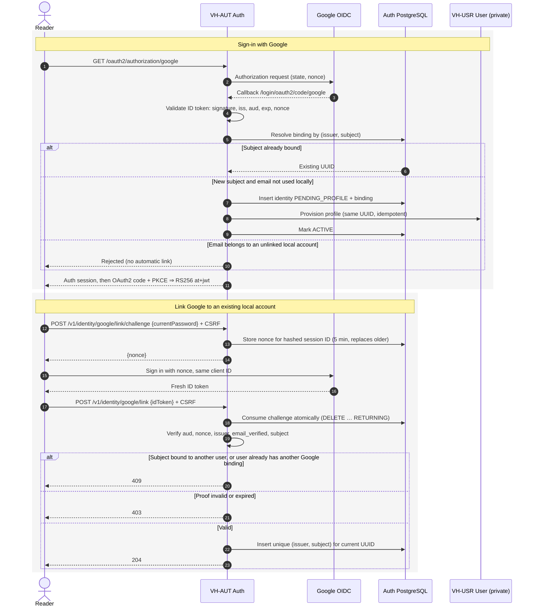

# Sequence — Google sign-in and manual account link (Auth)

Google is an upstream OIDC provider only, enabled with `vellum.google.enabled=true`. Auth binds the verified `(issuer, subject)` to one VellumHub UUIDv7 and keeps issuing its own access tokens. **Email is never a link key**, and a Google ID token is never accepted as an API bearer. The Gateway does not route these Auth endpoints.

| Control | Implementation |
| --- | --- |
| Federated login and canonical principal | [GoogleFederationConfig](../../../services/auth-service/src/main/java/com/vellumhub/auth/config/GoogleFederationConfig.java) · [FederatedIdentityService](../../../services/auth-service/src/main/java/com/vellumhub/auth/identity/FederatedIdentityService.java) |
| Link challenge and proof | [GoogleIdentityLinkController](../../../services/auth-service/src/main/java/com/vellumhub/auth/identity/GoogleIdentityLinkController.java) · [GoogleLinkChallengeRepository](../../../services/auth-service/src/main/java/com/vellumhub/auth/identity/GoogleLinkChallengeRepository.java) |
| Login/link throttle: 20 attempts per minute per remote address, `429` + `Retry-After` | [AuthenticationThrottleFilter](../../../services/auth-service/src/main/java/com/vellumhub/auth/config/AuthenticationThrottleFilter.java) |
| Sessions: JDBC, 30 min idle, 12 h absolute; logout does not revoke issued JWTs | [SessionLifecycleConfig](../../../services/auth-service/src/main/java/com/vellumhub/auth/config/SessionLifecycleConfig.java) · [AbsoluteSessionLifetimeFilter](../../../services/auth-service/src/main/java/com/vellumhub/auth/config/AbsoluteSessionLifetimeFilter.java) |

There is no unlink endpoint. CI proves the protocol with a controlled signed OIDC upstream (`FederatedOidcLifecycleIntegrationTest`); a live Google browser flow behind HTTPS is not evidenced. Local setup and secrets: [Auth service](../../../services/auth-service/README.md).
