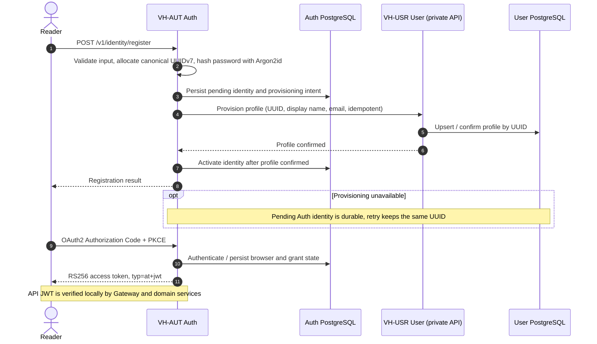

# Sequence — Auth registration and User profile provisioning

The current topology has a **separate Auth issuer**. Auth provisions a User profile using the same canonical UUID; User is not a fallback issuer. Google federation is an optional identity provider path, not a replacement for VellumHub API tokens.

**Evidence / ownership:** [Auth service](../services/auth.md) · [User service](../services/user.md) · [Auth implementation](../../../services/auth-service/README.md) · [authorization sequence](api-request-authorization.md) · [identity states](../states/auth-identity-lifecycle.md). The sequence abstracts provider/browser redirects; it does **not** claim that a live Google callback, HTTPS reverse proxy or real frontend has been deployed.
