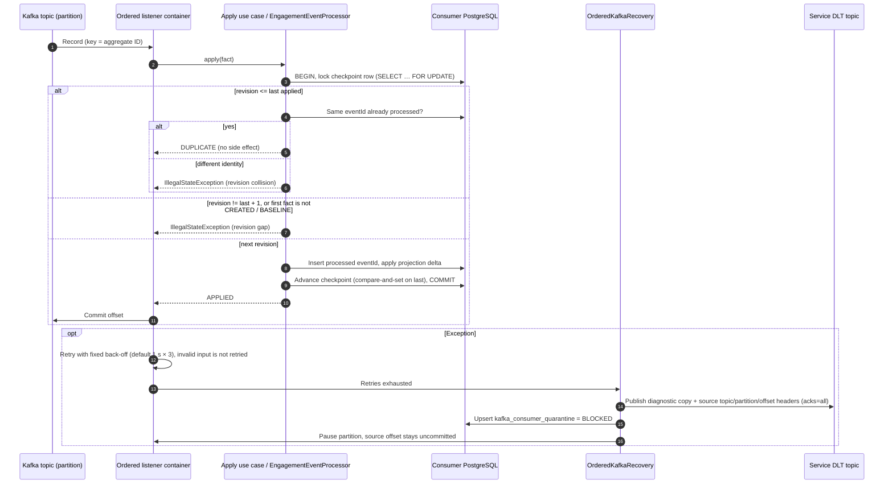

# Sequence — ordered Kafka consumer with checkpoint and quarantine

Engagement and Recommendation apply canonical facts (Book, ReadingProgress, Rating, Reaction) **per aggregate in revision order**. The projection change, the checkpoint and the processed-event record commit in one PostgreSQL transaction; the Kafka offset is committed only after that. Delivery is at-least-once, so duplicates are expected and absorbed.

| Step | Implementation |
| --- | --- |
| Book revision rule (`verifyRevisionContinuity`) | Engagement [ApplyBookEventUseCase](../../../services/engagement-service/src/main/java/com/vellumhub/engagement_service/module/book_event/application/use_case/ApplyBookEventUseCase.java) · Recommendation [ApplyBookEventUseCase](../../../services/recommendation-service/src/main/java/com/vellumhub/recommendation_service/module/book_event/application/use_case/ApplyBookEventUseCase.java) |
| Rating/Reaction checkpoint, duplicate and collision rules | [EngagementEventProcessor](../../../services/recommendation-service/src/main/java/com/vellumhub/recommendation_service/module/user_profile/infrastructure/consumer/EngagementEventProcessor.java) |
| Retry, DLT, quarantine, partition pause | [OrderedKafkaRecovery](../../../services/recommendation-service/src/main/java/com/vellumhub/recommendation_service/share/kafka/recovery/OrderedKafkaRecovery.java) (identical copy in Engagement, guarded by `tools/architecture/test_ordered_recovery_parity.py`) |
| Real Kafka + PostgreSQL proof | `ConsumerIdempotencyDistributedTest` |

The DLT is diagnostic only: records are never re-appended to the tail of an ordered topic. Recovery resumes from the **original** offset — see the [quarantine state machine](../states/kafka-quarantine.md) and the [recovery runbook](../../KAFKA_RECOVERY_RUNBOOK.md).
