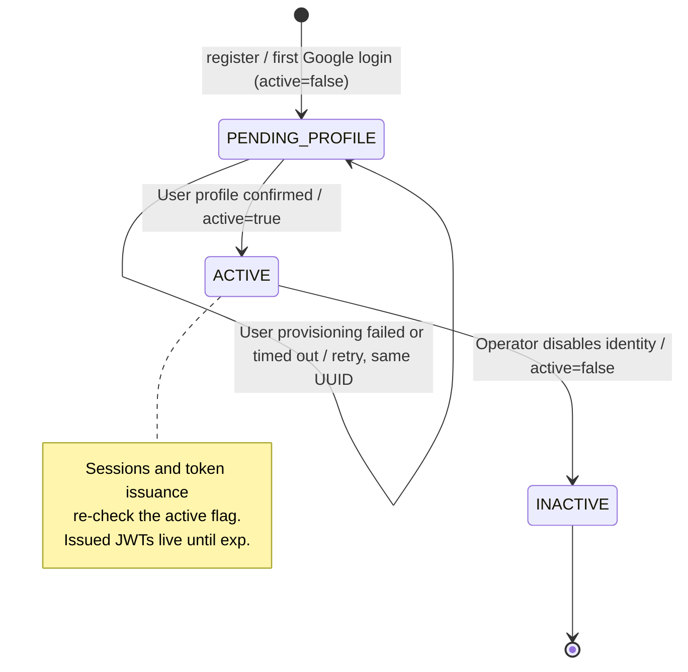

# State machine — Auth identity provisioning

**Persisted** in `auth_identity.provisioning_state` and `auth_identity.active`. An identity becomes usable only after User confirms the profile with the same UUID, so a failed provisioning call never creates a half-registered account that can log in.

| Transition | Guard | Implementation |
| --- | --- | --- |
| → PENDING_PROFILE | Local registration (Argon2id credential) or new Google subject; UUIDv7 allocated once | [OnboardingIdentityRepository](../../../services/auth-service/src/main/java/com/vellumhub/auth/identity/OnboardingIdentityRepository.java) · [FederatedIdentityRepository](../../../services/auth-service/src/main/java/com/vellumhub/auth/identity/FederatedIdentityRepository.java) |
| PENDING_PROFILE → PENDING_PROFILE | Provisioning error keeps the durable row; reconciliation retries with the original UUID | [IdentityRegistrationService](../../../services/auth-service/src/main/java/com/vellumhub/auth/identity/IdentityRegistrationService.java) · [ProfileProvisioningClient](../../../services/auth-service/src/main/java/com/vellumhub/auth/identity/ProfileProvisioningClient.java) |
| PENDING_PROFILE → ACTIVE | `UPDATE … WHERE provisioning_state='PENDING_PROFILE'` after User returns 201/204 | same repositories |
| ACTIVE → INACTIVE | `active=false`; existing sessions are rejected and no new token is issued | [ActiveIdentitySessionFilter](../../../services/auth-service/src/main/java/com/vellumhub/auth/config/ActiveIdentitySessionFilter.java) |

User exposes provisioning only on the internal network (`POST /internal/identity/profiles`, `VELLUM_INTERNAL_PROVISION_KEY`): 201 creates, 204 is an exact replay, 409 is a collision. See the [registration sequence](../flows/identity-onboarding.md).
