# State machine — Catalog cache configuration rollout

**Operational configuration state, not a persisted Book domain entity.** These are the permitted **fleet-wide phases** for a production-like rollout. A local Compose profile may bootstrap directly with both flags ON because it starts all services from the same revision; that fact does not validate a live mixed-version deployment.

```mermaid
stateDiagram-v2
    [*] --> OFF: Production default
    state "OFF: read=false / invalidate=false" as OFF
    state "INVALIDATING: read=false / invalidate=true" as INVALIDATING
    state "ACTIVE: read=true / invalidate=true" as ACTIVE
    OFF --> INVALIDATING: Deploy all writer replicas with new invalidation code
    INVALIDATING --> ACTIVE: Confirm all writers upgraded; canary readers gradually
    ACTIVE --> INVALIDATING: Disable reads in every pod (rollback first)
    INVALIDATING --> OFF: Disable invalidation after all readers are OFF
    note right of ACTIVE
      Read=true and invalidate=false
      is forbidden at startup.
      Old writer binaries cannot coexist
      with cache-reading replicas.
    end note
```

| Phase | Catalog read flag | Catalog invalidation flag | Required proof |
| --- | --- | --- | --- |
| OFF | `false` | `false` | Safe PostgreSQL-only behavior |
| INVALIDATING | `false` | `true` | **All** Book writers register after-commit invalidation, including writer pods not serving cached reads |
| ACTIVE | `true` | `true` | Verified Redis/ACL/TLS, hit distribution, error rate, p95/p99, rollback and freshness in a real target environment |

`CATALOG_CACHE_ENABLED` and `CATALOG_CACHE_INVALIDATION_ENABLED` are separate. The app rejects reads ON with invalidation OFF. An old binary from before PR #370 that skips invalidation when read-OFF is **not safe to mix with a cache-reading pod**, even if the new code is correct. Backout sequence: **ACTIVE → INVALIDATING → OFF**. Production overlay currently remains OFF, and its Redis hostname is not a provisioned endpoint. See [runbook](../../CATALOG_REDIS_CACHE.md) and [cache read sequence](../flows/catalog-cache.md).
