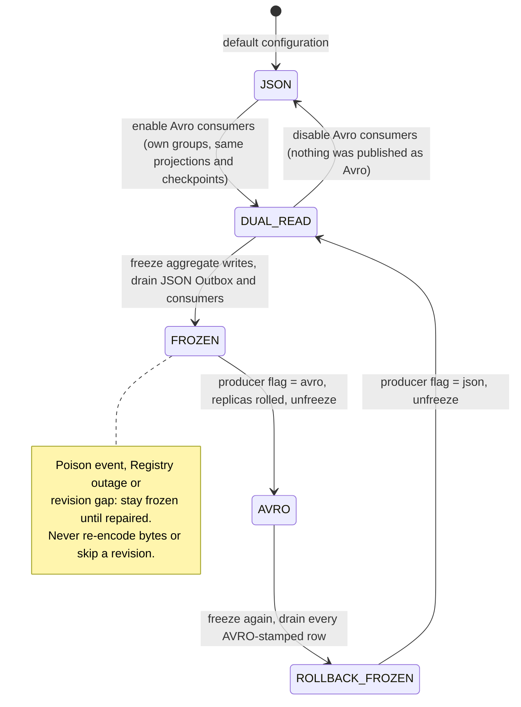

# State machine — JSON → Avro wire format per stream

Each canonical stream (Book, ReadingProgress, Ratings, Reactions) is switched independently. The **default today is JSON** (`*-wire-format=json`, Avro consumers disabled). Every Outbox row stamps an immutable `wire_format` and `payload_schema_version`, so a row keeps its destination even if the producer flag later changes.

| State | Producer (`app.*.events.wire-format`) | Consumers |
| --- | --- | --- |
| JSON | `json` | JSON listeners only |
| DUAL_READ | `json` | JSON + Avro listeners (`app.*.avro.consumer-enabled=true`) |
| FROZEN / ROLLBACK_FROZEN | unchanged; DB write gate closed | both, until backlog and checkpoints match |
| AVRO | `avro`; schema resolved from Registry, never auto-registered | both kept until formal retirement |

Schemas live in [`lib/kafka-avro-contracts`](../../../lib/kafka-avro-contracts) under `BACKWARD_TRANSITIVE` subjects ([Registry operations](../../SCHEMA_REGISTRY_OPERATIONS.md)). Step-by-step commands and GO/NO-GO checks per stream: [Book](../../BOOK_AVRO_CUTOVER_RUNBOOK.md) · [Engagement](../../ENGAGEMENT_AVRO_CUTOVER_RUNBOOK.md) · [Reading progress](../../READING_PROGRESS_AVRO_CUTOVER_RUNBOOK.md). A fresh environment can start directly in Avro: [fresh Avro installation](../../FRESH_AVRO_INSTALLATION.md).
