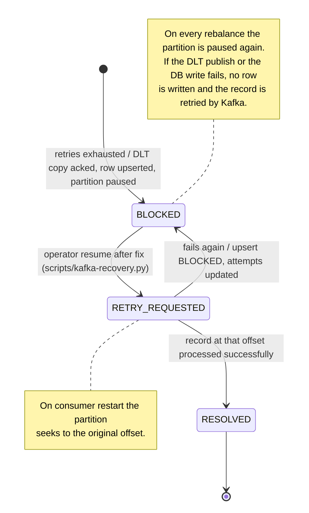

# State machine — ordered consumer quarantine

**Persisted** in `kafka_consumer_quarantine.status` (`CHECK status IN ('BLOCKED','RETRY_REQUESTED','RESOLVED')`), one row per consumer group + source topic/partition/offset. A non-resolved row keeps its partition from progressing, so no later revision of the same aggregate is applied out of order.

| Transition | Guard | Implementation |
| --- | --- | --- |
| → BLOCKED | `DefaultErrorHandler` exhausted, or non-retryable (`IllegalArgumentException`, `DeserializationException`, `DataIntegrityViolationException` ⇒ category `INVALID`) | `OrderedKafkaRecovery.quarantine` |
| BLOCKED (rebalance) | `onPartitionsAssigned` finds the oldest non-resolved row with `BLOCKED` ⇒ `consumer.pause` | `OrderedKafkaRecovery.configure` |
| BLOCKED → RETRY_REQUESTED | Script refuses unless the row is `BLOCKED`; dry run by default | [kafka-recovery.py](../../../scripts/kafka-recovery.py) |
| RETRY_REQUESTED (restart) | `onPartitionsAssigned` ⇒ `consumer.seek(originalOffset)` | `OrderedKafkaRecovery.configure` |
| RETRY_REQUESTED → RESOLVED | Record interceptor `success` updates the matching row; metric `vellumhub.kafka.recovery.resolved` | `OrderedKafkaRecovery.configure` |

Metrics: `vellumhub.kafka.recovery.retry`, `.quarantined` (with `category`), `.resolved`. Operator procedure and crash windows: [Kafka recovery runbook](../../KAFKA_RECOVERY_RUNBOOK.md). Tables: Engagement `V9__kafka_consumer_quarantine.sql`, Recommendation `V5__kafka_consumer_quarantine.sql`.
