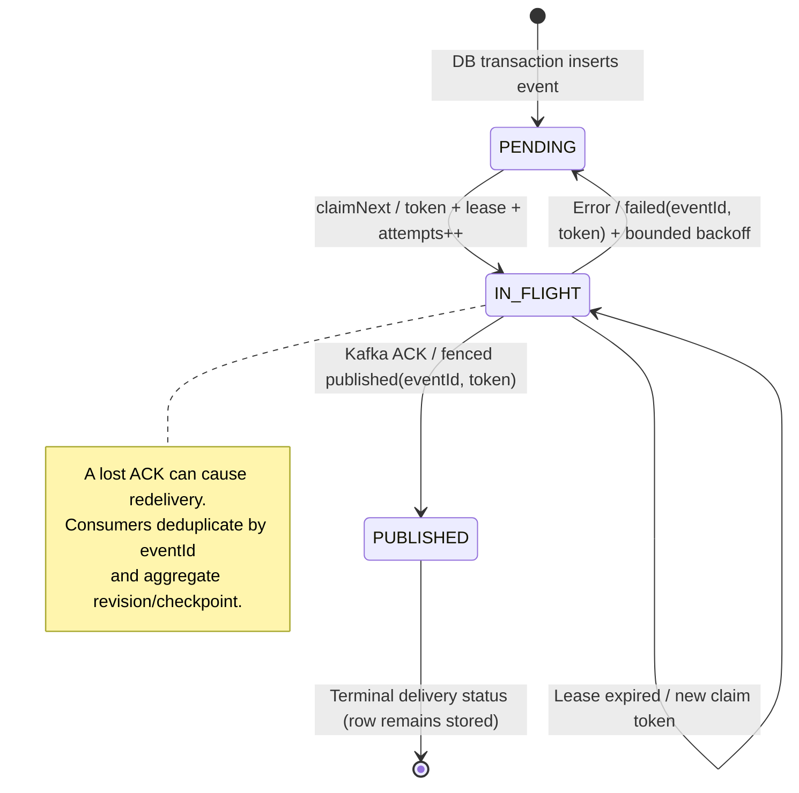

# State machine — Catalog Outbox event delivery

**This is a persisted state machine**, derived from `JdbcOutboxStore`: exactly `PENDING`, `IN_FLIGHT` and `PUBLISHED`. A failed Kafka send does **not** persist a terminal `FAILED` state; it returns to `PENDING` with an error, backoff timestamp and incremented attempt count. Claim token and lease fence concurrent dispatchers.

| Transition | Guard / failure mode | Implementation |
| --- | --- | --- |
| Insert → PENDING | Committed canonical aggregate + Outbox record; rollback inserts neither | [JdbcOutboxWriter](../../../services/catalog-service/src/main/java/com/vellumhub/catalog_service/module/outbox/infrastructure/persistence/JdbcOutboxWriter.java) |
| PENDING → IN_FLIGHT | Due `next_attempt_at` and no earlier un-published aggregate revision; row `SKIP LOCKED` | [claimNext](../../../services/catalog-service/src/main/java/com/vellumhub/catalog_service/module/outbox/infrastructure/persistence/JdbcOutboxStore.java) |
| IN_FLIGHT → PUBLISHED | Kafka ACK; matching `claim_token` prevents stale workers finalizing | [OutboxDispatcher](../../../services/catalog-service/src/main/java/com/vellumhub/catalog_service/module/outbox/infrastructure/dispatcher/OutboxDispatcher.java) |
| IN_FLIGHT → PENDING | Failure; exponential bounded backoff (at most 300 s) | [OutboxDispatcher](../../../services/catalog-service/src/main/java/com/vellumhub/catalog_service/module/outbox/infrastructure/dispatcher/OutboxDispatcher.java) |
| IN_FLIGHT → IN_FLIGHT | Lease expiration allows reclaim with a new token | [JdbcOutboxStore](../../../services/catalog-service/src/main/java/com/vellumhub/catalog_service/module/outbox/infrastructure/persistence/JdbcOutboxStore.java) |

No globally exactly-once delivery is claimed. Kafka ACK plus an unsuccessful PUBLISHED update can lead to retry and duplicate downstream facts, so consumer idempotency remains necessary. See [sequence diagram](../flows/book-outbox.md) and [consumer contracts](../../CONSUMER_IDEMPOTENCY.md).
